# 🧠 项目架构拆解与逻辑思维导图

本项目之所以能帮公司快速学习先进 AI 架构，是因为它建立了一套**严密的逻辑推演闭环**：从**业务难题分类**到**双层维度拆解**，再到**工程代码实现**与**落地决策指导**。

---

## 🗺️ 核心逻辑思维导图

```mermaid
flowchart TD
    Root["🎯 核心命题: 如何拆解并借鉴先进 AI 应用的 Harness 架构？"]

    %% 第一层：为什么不能一刀切
    Root --> Layer1["第 1 层：为什么不能用同一套标准硬套？<br/>(业务异构性)"]
    Layer1 --> L1_1["传统误区: 把所有 AI 都当成 Prompt + API"]
    Layer1 --> L1_2["本质差异: 生产级 Agent 的壁垒在 Harness (工程脚手架)"]
    Layer1 --> L1_3["推导结论: 必须按'核心工程难题'前置分类"]

    %% 第二层：五大核心难题分类
    Root --> Layer2["第 2 层：五大品类与核心工程瓶颈<br/>(分类定性)"]
    Layer2 --> C1["🔧 工程型 (Cursor/Devin)<br/>瓶颈: 不可逆真实操作 -> 强依赖沙箱、AST/LSP 切片、Diff回滚"]
    Layer2 --> C2["📊 数据型 (ChatBI)<br/>瓶颈: 幻觉会导致业务灾难 -> 强依赖 Schema剪枝、SQL静态语法树拦截、报错自愈"]
    Layer2 --> C3["🧠 知识型 (Perplexity)<br/>瓶颈: 幻觉与无据可依 -> 强依赖网络去噪、Cross-Encoder重排、句级引用溯源"]
    Layer2 --> C4["🎨 创作型 (Midjourney/v0)<br/>瓶颈: 一次生成难达标 -> 强依赖多模态异构管线、实时预览、分支变体"]
    Layer2 --> C5["🤖 自动化型 (AutoGPT)<br/>瓶颈: 长链路极易崩溃 -> 强依赖 DAG状态机、单步反思纠偏、容器沙箱"]

    %% 第三层：双层拆解分析模型
    Root --> Layer3["第 3 层：双层 Harness 拆解模型<br/>(共性对比 + 深度穿透)"]
    Layer3 --> SubCommon["共性层 (9大通用维度)<br/>提供横向对标基础"]
    SubCommon --> D1["1. Agent 编排 (单/多/Swarm)"]
    SubCommon --> D2["2. 模型路由 (分级/混合/降级)"]
    SubCommon --> D3["3. 工具链 (粒度/协议/注册)"]
    SubCommon --> D4["4. Prompt 工程 (系统约束/规则注入)"]
    SubCommon --> D5["5. 上下文工程 (检索/压缩/切片)"]
    SubCommon --> D6["6. 数据流与状态 (流水线/状态机/快照)"]
    SubCommon --> D7["7. 安全沙箱 (进程/网络/权限边界)"]
    SubCommon --> D8["8. 人机协同 (自主度/审查粒度/交互)"]
    SubCommon --> D9["9. 扩展生态 (MCP/插件/配置)"]

    Layer3 --> SubSpec["特性层 (5大专属维度)<br/>分类后解锁深度追问"]
    SubSpec --> S1["工程专属: 沙箱模型 / 代码理解 / Diff管理 / 终端管理 / 回滚机制"]
    SubSpec --> S2["数据专属: NL2SQL管线 / 异构数据适配 / Schema发现 / 优化与安全 / 可视化引擎"]
    SubSpec --> S3["知识专属: RAG全链路 / 向量索引 / 引用链管理 / 多文档推理 / 知识更新"]
    SubSpec --> S4["创作专属: 多模态管线 / 版本变体 / 实时预览 / 风格一致性 / 模板复用"]
    SubSpec --> S5["自动化专属: DAG状态机 / 多Agent协议 / 容错重试 / 外部集成 / 触发调度"]

    %% 第四层：系统工程落地实现
    Root --> Layer4["第 4 层：软件工程系统实现<br/>(代码如何落地)"]
    Layer4 --> M1["CLI 交互层: Typer + Rich 终端高亮展示"]
    Layer4 --> M2["采集器层: GitHub API + 网页正文去噪爬虫"]
    Layer4 --> M3["分析引擎层: LiteLLM + 5大专属分析器 + 离线基准知识库"]
    Layer4 --> M4["知识注册表: YAML 维护 22+ 款典型产品画像"]
    Layer4 --> M5["存储与报告: SQLite 结果持久化 + Mermaid/Markdown 报告渲染"]

    %% 第五层：对公司的落地交付价值
    Root --> Layer5["第 5 层：公司项目搭建借鉴指引<br/>(落地决策转化)"]
    Layer5 --> V1["架构选型: 做代码助手照搬 Cursor，做内部 BI 照搬 ChatBI"]
    Layer5 --> V2["避坑指南: 不在不关键维度过度设计 (如数据型做花哨多Agent)"]
    Layer5 --> V3["成本控制: 模型路由与 Prompt 补丁压缩降低 Token 消耗"]
```



---

## 🔍 深度拆解剖析

### 1. 为什么“Harness”是 AI 应用的胜负手？

在 2023 年，很多人认为做 AI 产品就是 `User -> Prompt -> LLM API -> Output`。
但到了今天，行业发现 **LLM 本身只是发动机，真正决定产品能否上线、好不好用的是 Harness（车架、悬挂、变速箱与刹车）**：

- **没有沙箱与回滚机制**：AI 编程助手可能会误删整个工程代码；
- **没有 Schema 剪枝与 AST 静态校验**：ChatBI 会生成危害数据库性能的烂 SQL 甚至越权泄露数据；
- **没有 Cross-Encoder 重排与引用链映射**：AI 搜索就会一本正经地胡说八道；
- **没有细腻的人机协同 Diff 设计**：开发者对 AI 就会失去控制感与信任感。

---

### 2. 核心逻辑推导四步法

```
【第一步：分类】确定产品要解决的核心工程瓶颈
        ↓
【第二步：定权】在 9 大共性维度中给重要指标赋予 1~5 分权重（避免平均用力）
        ↓
【第三步：穿透】解锁该品类的 5 大专属维度，追问底层架构实现细节
        ↓
【第四步：对标】输出 Mermaid 架构拓扑与关键设计决策（Takeaways），转化为公司项目自建清单
```

---

### 3. 系统代码模块映射关系

项目的每个代码目录都严谨对应上述逻辑：

| 逻辑层次 | 代码目录 | 职责与实现细节 |
| :--- | :--- | :--- |
| **元数据与分类标准** | `src/harness_analyzer/models/` | Pydantic 定义 `AppCategory`、`CommonDimension`、`SpecializedDimension` 与权重矩阵 |
| **公开信息事实资产** | `src/harness_analyzer/registry/` | YAML 维护 22+ 款主流应用的分类、官方博客、GitHub 仓库等结构化来源 |
| **数据采集管道** | `src/harness_analyzer/collectors/` | 异步采集 GitHub 代码树结构与技术博客文档 |
| **双层分析引擎** | `src/harness_analyzer/analyzer/` | 9 维度通用提取器 + 5 大专属分析器 (`engineering.py`, `data_analysis.py` 等) + 离线基准库 |
| **报告生成与可视化** | `src/harness_analyzer/output/` | 生成标准 Markdown 报告、横向对比表格与 Mermaid 架构图 |
| **持久化与终端呈现** | `src/harness_analyzer/storage/` & `cli.py` | SQLite 存储缓存历史分析，Rich 渲染美观终端交互 |
