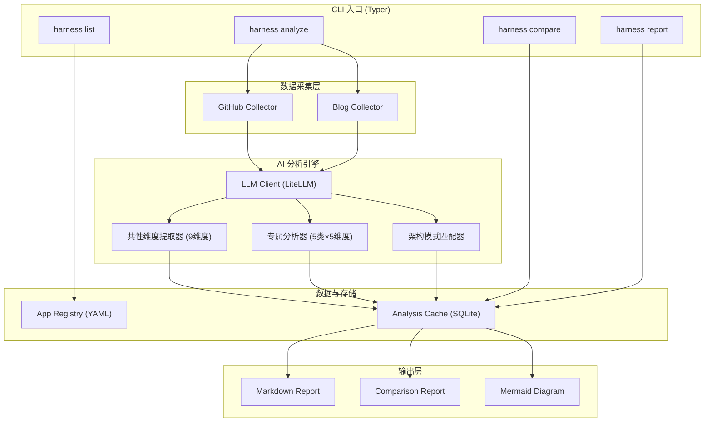

# AI Harness Analyzer — 项目方案

## 🎯 项目定位

**一句话描述**：一个 CLI 工具，从公开信息源自动采集并解析 AI 应用的底层架构（Harness），生成结构化的分析报告，帮助团队快速理解先进 AI 产品的工程实践。

## 📐 核心概念：Harness 架构拆解

### 双层分析框架

```
分类定性 → 共性层（9 维度通用分析）+ 特性层（品类专属 5 维度深度分析）
```

分类不是为了贴标签，是为了解锁第二层分析。没有分类，分析就只有 9 个通用维度的泛泛之谈；有了分类，才能追问那些真正有落地指导价值的问题。

### 分析流程

```
输入 AI 应用 → 分类定性 → 共性层 9 维度 → 特性层 5 维度 → 架构模式提取 → 可借鉴的设计决策
```

## 🏗️ 系统架构



## 📂 项目结构

```
harness/
├── pyproject.toml
├── README.md
├── .env.example
├── docs/                       # 项目知识库
│   ├── project-plan.md         # 项目方案
│   ├── classification.md       # 分类体系
│   └── dimensions.md           # 维度框架
├── src/harness_analyzer/
│   ├── cli.py                  # CLI 入口
│   ├── config.py               # 配置管理
│   ├── models/                 # 数据模型
│   ├── registry/               # 应用注册表
│   ├── collectors/             # 数据采集
│   ├── analyzer/               # AI 分析引擎
│   │   ├── specialized/        # 5类专属分析器
│   │   ├── dimensions.py       # 9维度提取器
│   │   └── llm.py              # LLM 客户端
│   ├── output/                 # 报告生成
│   └── storage/                # SQLite 缓存
├── data/
│   ├── prompts/                # LLM Prompt 模板
│   └── patterns/               # 架构模式库
└── reports/                    # 生成的报告
```

## 🔧 技术栈

| 组件 | 选型 | 理由 |
|------|------|------|
| 语言 | Python 3.11+ | AI 生态最成熟 |
| CLI | Typer + Rich | 现代 CLI 体验 |
| LLM | LiteLLM | 统一接口，支持 Gemini/Claude/OpenAI |
| 数据模型 | Pydantic v2 | 强类型验证 |
| HTTP | httpx | 异步支持 |
| 缓存 | SQLite | 零依赖 |
| 配置 | PyYAML + python-dotenv | 灵活配置 |

## 🚀 CLI 使用

```bash
pip install -e .

harness list                              # 列出所有应用
harness info cursor                       # 查看应用详情
harness analyze cursor                    # 分析 Cursor 的架构
harness compare cursor devin antigravity  # 对比多个应用
harness report cursor                     # 查看已缓存报告
```
