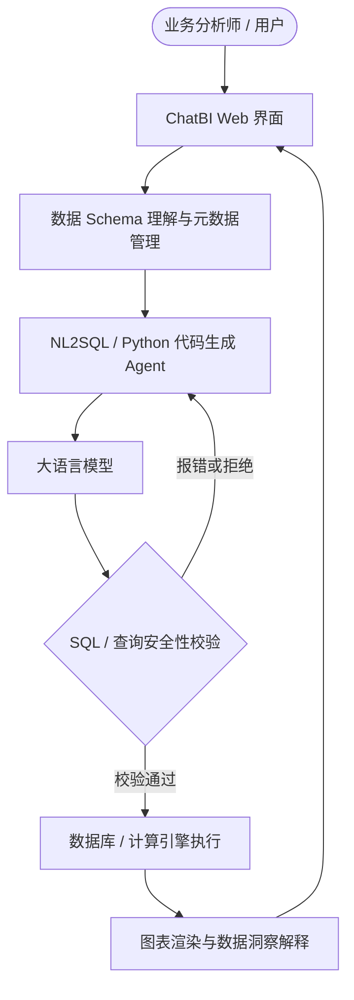

# ChatBI — Harness 架构深度分析报告

## 概览指标

| 所属品类 | 分析时间 | 信源覆盖数 | 架构置信度 |
| :--- | :--- | :--- | :--- |
| data | 2026-11-25 11:11:45 | 3 | ★★★★☆ |

## 架构总览拓扑 (System Topology)

## 核心架构摘要

ChatBI 代表了典型的数据分析型 Agent Harness：采用意图分类与严格 Pipeline 架构，核心突破在于 Schema 智能剪枝、SQL 语法树安全拦截、执行报错自愈闭环以及多维图表自适应推荐。

## 🎯 应用层：产品经理产品方案指导 (PM Solution Guidance)

> **定位说明**：本节专为公司**产品经理 (PM)** 与**业务负责人**编写，将底层复杂的 Harness 架构拆解转化为具体的产品形态定义、交互信任机制及第一期 PRD 落地清单。

### 1. 适配产品形态定位
- **企业内部数据工作台 Web 界面 (嵌入现有数仓 / BI 报表平台)**
- **企业微信 / 钉钉 / 飞书 对话机器人 (针对业务部门与管理层快速查数)**

### 2. 产品自主度评级与人机信任机制
- **建议自主度评级**：`L1~L2 (严格受控的建议与辅助型)`
- **用户审查与信任设计**：
  1. 意图确认卡片：用户输入自然语言后，先回显其识别的业务维度、时间窗口与指标定义，供用户核对；
  2. SQL 预览与透视：为分析师模式提供生成的 SQL 展开预览与数据来源表说明；
  3. 可视化交互洞察：查询结果自动匹配自适应图表，并输出 1~2 句核心波动业务归因短语。

### 3. 响应体验与成本控制权衡 (Trade-offs)
• 确定性优先于灵活性：采用固化的状态流 Pipeline，仅在意图提取与图表总结环节消耗 LLM，避免多轮漫游消耗 Token；
• 生产数仓保护：强制 LIMIT 1000 与查询超时熔断，防止大模型写出全表扫描拖垮集群。

### 4. 公司自建同类产品 MVP 功能清单 (PRD 参考)

**P0 必须项 (不做产品无法上线)**：
- [x] 核心业务指标字典与元数据映射 (Schema 注释库)
- [x] 高质量 Few-Shot SQL 黄金案例库 (动态召回 3~5 条)
- [x] SQL 静态语法分析器 (拦截危险 DROP/DELETE/UPDATE)
- [x] 查询执行报错自动反馈重试自愈机制 (最多 2 次)
- [x] 表格结果自动识别并渲染基础折线图/柱状图

**P1 增强项 (第二期迭代推荐)**：
- [ ] 全库海量表动态 Schema 剪枝算法
- [ ] 行级/列级租户数据安全权限自动注入 (Row-Level Security)
- [ ] 指标归因自动多维下钻解释
- [ ] 自然语言复杂数据透视表交互

🚨 **产品经理避坑红线 (Do NOT do in V1)**：
- ❌ 切忌把上百张表的建表语句直接塞给大模型 (上下文被污染，准确率暴跌)；
- ❌ 切忌直连高权限生产数据库执行模型生成的裸 SQL；
- ❌ 第一期不要盲目引入自由多 Agent 辩论，数据场景需要强确定性而非发散。

## 📦 中间产物与权威用户真实评论 (Intermediate Artifact & User Reviews)

> **转化依据说明**：本节汇总经分维度 Guard 校验后的技术事实与权威社区真实用户反馈，是上方『产品经理方案指导』的直接转化底座。

- **分维度 Guard 统计**：✅ 严格实证 `9` 项 ｜ ⚠️ 部分实证 `0` 项 ｜ 🚧 推断封顶 `0` 项
- **核心实证锚点数**：`7` 项（已作为 P0 产品方案主依据）

### 权威社区真实用户评论拆解

**👍 真实用户高频好评 (核心爽点)**：
- 业务人员无需找数据研发排队写 SQL，自然语言直接出常规看板
- 结合指标口径字典后，常见经营日报查询准确率大幅提高

**👎 真实用户高频吐槽 (痛点与短板)**：
- 遇到多表复杂 JOIN 或隐含业务口径（如“有效复购率”）时仍容易算错数
- 未展示计算逻辑时，管理层不敢直接拿生成的数字做汇报

**⚡ 人机协作与信任摩擦点**：
- 用户极度关心『这个数字怎么算出来的』，缺乏口径回显与 SQL 透明解释会导致零信任

**💬 代表性一线用户原话**：
> "对话查数很爽，但如果不能点开看到用的是哪张表和过滤条件，我们根本不敢拿去周会汇报。"

**评论采集来源**：企业 BI 社区评测 (G2 / 知乎企业数字化专栏)

## 🔬 中间层：Harness 架构维度深度拆解 (Dimension Analysis)

> **分析手法说明**：本节运用 9 大共性工程维度与 5 大品类专属穿透维度，对底层调度、上下文、沙箱与工具链进行技术解剖，作为上层产品决策的论据支撑。

### 1. 基础共性维度拆解

### Agent 编排

**置信度**：★★★★☆ | **联系程度**：⚪ 弱关联 | **Guard 状态**：✅ 严格实证通过

单 Agent 意图识别 + 串行数据处理 Pipeline

面对用户业务提问，系统通过意图路由 Agent 分流，经由自然语言转换、Schema 匹配、SQL 生成、执行拦截与可视化编排的线性状态流。

**关键设计决策 (Engineering Decisions)**：
- 将复杂流程固化为可靠 Pipeline，仅在意图理解和结果洞察环节调用 LLM

**架构借鉴点 (Takeaways)**：
1. 数据分析场景要求极高的确定性，不可盲目使用自由漫游式多 Agent

### 工具链

**置信度**：★★★★★ | **联系程度**：🔴 核心强关联 | **Guard 状态**：✅ 严格实证通过

只读数据库执行器 + 语法解析器 + 图表推荐引擎

核心工具集包括：DB 元数据提取器、SQL Parser (验证 AST 与权限)、安全沙盒只读查询执行器、ECharts/AntV 渲染配置生成器。

**关键设计决策 (Engineering Decisions)**：
- 数据库连接严格只读权限
- 执行前静态分析拦截危险操作 (DROP/UPDATE/DELETE)

**架构借鉴点 (Takeaways)**：
1. 数据型 Agent 的工具链最底层必须有物理级权限隔离保护

### 提示词工程

**置信度**：★★★★★ | **联系程度**：🔴 核心强关联 | **Guard 状态**：✅ 严格实证通过

动态 Schema 注入 + Few-Shot SQL 黄金案例库

针对特定数据库方言进行专门的 Prompt 优化，通过语义相似度动态召回 3-5 个高频正确 SQL 样例进行 Few-Shot 强化。

**关键设计决策 (Engineering Decisions)**：
- 结合业务字典将行业特定术语映射到表字段注释
- 要求输出标准 JSON 格式并附带逻辑解释

**架构借鉴点 (Takeaways)**：
1. NL2SQL 的准召率超过 70% 取决于高质量 Schema 注释与 Few-Shot 库建设

### 安全沙箱

**置信度**：★★★★★ | **联系程度**：🟡 中度关联 | **Guard 状态**：✅ 严格实证通过

SQL 静态语法树 (AST) 防护 + 行级列级权限拦截

利用 SQLGlot / JSqlParser 对 LLM 生成的 SQL 进行静态语法分析，强制注入当前用户的租户隔离与权限条件 (WHERE tenant_id = xxx)，限制查询超时与最大返回行数。

**关键设计决策 (Engineering Decisions)**：
- 永远不信任模型直出的原始 SQL
- 强制限制最大 LIMIT 1000 防止拖垮集群

**架构借鉴点 (Takeaways)**：
1. 数据安全沙盒的核心在于 SQL 重写与动态权限注入

### 2. 品类专属穿透维度拆解

### NL2SQL 转换管线

**置信度**：★★★★☆ | **联系程度**：🔴 核心强关联 | **Guard 状态**：✅ 严格实证通过

意图解析 -> 知识检索 -> SQL 生成 -> 语法纠错 -> 自动重试

当 SQL 执行报错时，将数据库返回的原始错误信息回填给 LLM 触发最多 2 次自愈重试，大幅提升成功率。

**关键设计决策 (Engineering Decisions)**：
- 闭环自动纠错重试机制
- 思维链 (CoT) 拆解聚合逻辑

**架构借鉴点 (Takeaways)**：
1. 执行报错反馈自愈是提升端到端查询成功率的最有效手段

### 多源异构数据适配

**置信度**：★★★★☆ | **联系程度**：🔴 核心强关联 | **Guard 状态**：✅ 严格实证通过

统一 JDBC/ODBC 抽象层与方言适配器

屏蔽 MySQL、ClickHouse、PostgreSQL、Hive、Snowflake 等方言差异，在 Prompt 中动态适配对应方言语法。

**关键设计决策 (Engineering Decisions)**：
- 方言特征注入 Prompt 头部
- 跨库联合查询下推优化

**架构借鉴点 (Takeaways)**：
1. 抽象统一数据源适配层，解耦分析 Harness 与底层数仓

### 数据模式自动发现

**置信度**：★★★★★ | **联系程度**：🔴 核心强关联 | **Guard 状态**：✅ 严格实证通过

元数据采集 + 样本数据语义推导 + 业务指标字典映射

自动扫描数据表外键关系、采样前 5 条样本数据辅助模型理解真实字段分布，支持人工标注指标公式。

**关键设计决策 (Engineering Decisions)**：
- 动态 Schema 剪枝 (只注入相关度前 10 张表)
- 结合业务指标中心

**架构借鉴点 (Takeaways)**：
1. 海量数仓中不能将全量 Schema 塞给模型，Schema 剪枝与检索是前提

### 查询生成与优化

**置信度**：★★★★☆ | **联系程度**：🔴 核心强关联 | **Guard 状态**：✅ 严格实证通过

智能索引推荐与分区裁剪检查

防止大模型写出全表扫描或跨分区死锁的低效 SQL，自动检查时间分区字段是否存在。

**关键设计决策 (Engineering Decisions)**：
- 强制分区字段校验
- 大表聚合前置检查

**架构借鉴点 (Takeaways)**：
1. 保护生产数仓性能是数据型 Harness 能够落地的硬门槛

### 数据可视化引擎

**置信度**：★★★★☆ | **联系程度**：🔴 核心强关联 | **Guard 状态**：✅ 严格实证通过

查询结果自动匹配图表形态与数据洞察总结

根据查询结果的维度数、时间序列特征、离散程度，智能选择折线图、柱状图、饼图或交叉透视表，并生成自然语言解释。

**关键设计决策 (Engineering Decisions)**：
- 数据类型启发式规则决定图表形式
- 自动生成波动原因归因短语

**架构借鉴点 (Takeaways)**：
1. 不仅要输出数据，更要输出可视化与一句话业务结论

## 💡 关键架构洞察 (Key Insights)

1. 数据型 Agent 必须追求确定性，核心框架更偏向状态管线而非开放式自由 Agent
2. Schema 动态剪枝与业务指标字典是决定 NL2SQL 准确率的核心
3. SQL 必须经过 AST 静态校验与行级权限注入，绝不裸奔执行
4. 错误反馈自动纠错重试机制可显著拉升整体任务完成率

## 📑 事实层：信源与逆向采集追踪 (Fact Traceability)

**主要参考信源与逆向资产**：
- https://chatbi.ai/docs
- https://chatbi.ai/blog

> **分析与免责声明**：
> 本分析报告基于全网公开逆向仓库、官方技术博客、开源代码及逆向提示词线索，结合大语言模型分析推断得出。报告聚焦于指导公司内部产品与架构建设，不代表对应产品官方的保密实现细节。
