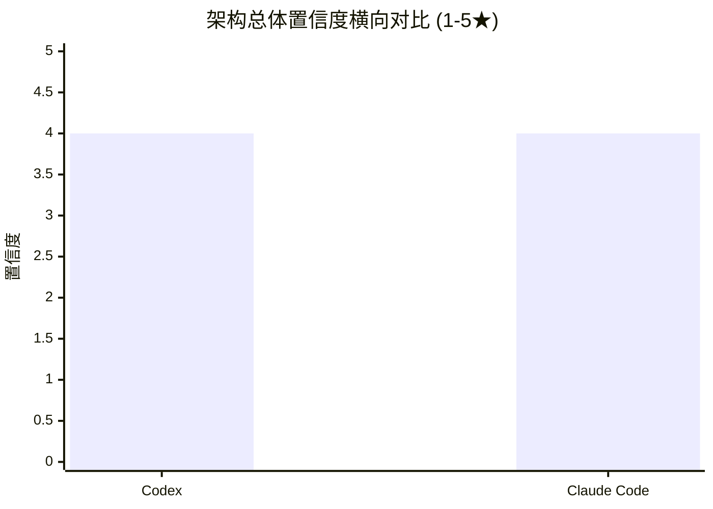
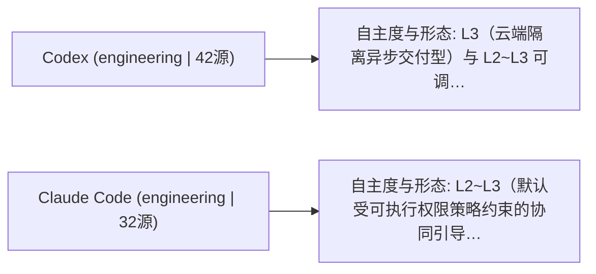

# AI Harness 架构对比报告：Codex vs Claude Code

> 生成时间：2026-11-26 11:58:11 | 对比数量：2 款 AI 应用

## 1. 概览横向对比

| 对比维度 | Codex | Claude Code |
| :--- | :--- | :--- |
| **应用分类** | engineering | engineering |
| **架构置信度** | ★★★★☆ | ★★★★☆ |
| **信息源数量** | 42 | 32 |
| **架构核心摘要** | OpenAI Codex 采用「Rust 高性能共享内核 (`codex-rs`) + 多宿主接口（本地终端 TUI/CLI、IDE App Server、Headless `exec`、Desktop App、Codex Web 云沙箱）... | Claude Code 采用「最小 Prompt + 强控制 Harness + 确定性 Agentic Loop」三层终端原生编码架构：系统与工具提示词以 `claude_code` preset 和六大核心工具描述实现“就近行为契约”，... |

## 2. 应用层：产品方案横向对比 (PM Guidance)

| 产品决策维度 | Codex | Claude Code |
| :--- | :--- | :--- |
| **适合产品形态** | 共享内核驱动的多宿主工程 Agent 套件（单 CLI/TUI 内核 + IDE 扩展 + 桌面客户端 + 云端异步 PR 工人）；具备强 OS 沙箱（文件与网络分离授权）的本地/CI 自动化修 Bug 与 PR 审查平台 | 终端原生 CLI Agent + IDE/桌面实时审查伴侣（Terminal + VS Code/JetBrains 多入口协同）；可编程嵌入式 Agent SDK（提供默认安全与工具 preset 供企业二次封装） |
| **自主度评级** | L3（云端隔离异步交付型）与 L2~L3 可调混合（本地借助 AskForApproval 与双维度沙箱精细控权） | L2~L3（默认受可执行权限策略约束的协同引导式：人类观看流式过程并在高风险动作前授权审批） |
| **MVP P0 必做项** | • 文件系统与网络访问分离的本地沙箱 + 提权重试二次审批机制 • 结构化增量补丁引擎 (`apply_patch` 协议与精确变更 Delta 回执) • 项目规约标准文件（`AGENTS.md`）+ Skills + MCP 工具标准接入 | • 专用低风险工具集合（Read/Edit/Grep）与可执行 Shell 审批权限门控 • Agentic Search + 项目根记忆文件（如 AGENTS.md / CLAUDE.md）持久化机制 • 可继承复用的核心 Preset + MCP 外部工具标准挂载 |
| **关键避坑红线** | ❌ 切忌在不做 OS/容器硬隔离的生产服务器环境下默认开放高危 shell 免确认模式（血泪案例已证明会损毁 systemd/容器）； ❌ 切忌高频烧 Token 的推理档位黑盒运行且缺乏每轮预算/额度预警； | ❌ 切忌完全依靠 System Prompt 嘱咐安全，而不在执行层写死权限校验与目录边界； ❌ 切忌发布客户端包时意外保留完整 source map 泄露内部未公开特性开关与业务逻辑； |

## 3. 中间层：关键架构维度对比

| 架构维度 | Codex | Claude Code |
| :--- | :--- | :--- |
| **Agent 编排** | [★★★★★｜2条实证] 单一 Rust 核心状态机协调工具调用、Guardian 权限评审、沙箱尝试与拒后重试升级，统一支撑 CLI、IDE App Server、Desktop 与云端任务 • *多入口（Terminal + IDE + Web）工程产品强烈推荐沉淀共享 headless 核心/Server 协议，避免各端各自维护一套 Agent 状态机* | [★★★★☆｜2条实证] 单主循环加专业子代理委派（Plan / Explore / Task Subagents）的确定性 Agentic Loop，支持终端 CLI、IDE 与 Agent SDK 复用 • *先把主 Agentic Loop 与子代理探索边界做清晰，比一开始堆砌复杂自由多 Agent 通信网更稳定* |
| **模型路由** | [★★★☆☆｜1条实证] 围绕 OpenAI GPT/Codex 系列推理档位（如 Reasoning Effort 中/高与 Codex-Max/Mini 分层）运行，也支持通过外部路由器接入自定义供应商模型 • *针对高频代码任务引入中等推理档位 / Mini 模型分层可大幅降低单次任务的 Token 消耗焦虑* | [★★★☆☆｜1条实证] 垂直绑定 Anthropic Claude 系列旗舰/轻量模型并依托云端 1M 上下文窗口，用户侧主要关注账号档位、配额速率与模型版本切换 • *第一方封闭模型+第一方 Harness 可以通过联合训练模型偏好工具调用契约获得更低格式错误率* |
| **工具链** | [★★★★★｜2条实证] 以结构化 `apply_patch` 补丁执行器和沙箱化命令执行器 (`codex_exec_server`) 为支柱，并原生内置 `@modelcontextprotocol/sdk` MCP 协议与网络审批工具链 • *将工具的「权限审批」「沙箱策略」抽象为正交 Trait/Middleware，能防止新增工具遗漏安全检查* | [★★★★★｜2条实证] 分层专用核心工具（Read / Edit / Grep / Bash / Agent / Skill）与 MCP 外部工具服务器标准接入，通过工具级提示约束强制 Bash 降权使用 • *减少不必要 Bash 泛化调用、把规则写进 Tool Description，可大幅降低误操作率与上下文噪音* |
| **提示词工程** | [★★★★★｜3条实证] 通过模型解析消息包 `codex_prompts::ResolvedModelMessages`、强类型标记片断（`BaseInstructionsFragment`、`AppsInstructions`）与 Hooks 注入文本（`HookPromptFragment`）精密管理提示分层 • *用带 provenance 元数据的结构化 Fragment 管理动态 System/Developer 提示，可避免长对话压缩时误删基础指令* | [★★★★★｜2条实证] 系统提示采用可复用的 `claude_code` preset（支持 `append` 扩展）与可共享 Skill 元模板机制，形成『系统总纲 + 工具微规程 + 项目记忆』三层体系 • *把产品内部锤炼成熟的 System Prompt 封装为 SDK Preset 并开放扩展点，利于沉淀生态* |
| **上下文工程** | [★★★★★｜2条实证] 支持增量工具窗口下的基线指令恢复（`base_instructions.rs`）、`AGENTS.md` 项目规约加载、以及标准化 Agent Skills 按需注入 • *多轮会话增量窗口模式下，必须显式打标基础 Developer 指令防止滑窗被切掉* | [★★★★☆｜2条实证] 采用 Agentic Search 自主检索大型代码库，配合 `CLAUDE.md` 跨会话持久化项目状态与 TODO，大幅降低手工挑选上下文的负担 • *在大型代码库场景，让 Agent 自主通过 Grep/Glob 渐进式探索上下文往往比盲目切块向量检索更准确* |
| **数据流与状态管理** | [★★★★☆｜2条实证] 基于 Rust 强类型 `codex_protocol` 事件与 `TurnEnvironment` / `TurnEnvironmentSelection` 状态模型，严格隔离每一轮对话的工具区目录与权限快照 • *将环境状态（工作区、权限快照、Hooks）显式绑定到每轮 Turn 上下文，杜绝跨会话越权状态泄漏* | [★★★★☆｜2条实证] 基于 `tool_use` / `tool_result` 对话事件流驱动执行状态机，跨会话/跨终端通过项目文件（`CLAUDE.md`）与 SDK 会话配置衔接 • *Before/After Tool Hooks 是实现审计日志、自动测试触发与企业安全策略拦截的最佳扩展位* |
| **安全沙箱** | [★★★★★｜2条实证] 纵深 OS 级沙箱 + Guardian 审查 + 粒度审批策略（`AskForApproval` / `NetworkSandboxPolicy` / `WindowsSandboxLevel` / `PROTECTED_METADATA_PATH_NAMES`），提权重试必须二次审查 • *OS 级沙箱 + 网络独立策略 + 提权复审是安全基线，同时 CLI 必须明确警告用户切勿在生产运维服务器开启高权限免审批模式* | [★★★★★｜2条实证] 可执行权限网关 + 写入限制 + Shell 命令审批确认（官方云/沙箱容器方案协同）保护本地开发机与代码仓安全 • *绝对不能用 System Prompt 代替权限代码：安全边界必须落在工具执行前的硬检查层* |
| **人机协同** | [★★★★★｜2条实证] 粒度可调审批流（`AskForApproval`、`GranularApprovalConfig`），覆盖 CLI TUI、IDE 扩展（VS Code/Cursor/Windsurf）、桌面端 (`codex app`) 与云端异步 PR 工作流 • *高自主产品容易滑向“黑盒消耗大量 Token + 高风险改动”，UI 上必须突出花费监控与高危边界预警* | [★★★★☆｜2条实证] 强调『人类可随时观察流式输出并介入引导（Human watches and steers）』的终端/IDE/桌面多端协同开发体验 • *即使 CLI 为主战场，覆盖 IDE 扩展与桌面端才能满足不同开发者的审查习惯* |
| **扩展生态** | [★★★★★｜2条实证] 开放标准 MCP 集成 (`@modelcontextprotocol/sdk`)、标准化 `AGENTS.md` / `Agent Skills` (`openai/skills`)、生命周期 Hooks 与 `app-server-protocol` 多端协议 • *定义清晰的 `app-server-protocol` RPC 契约可以让第三方的 IDE 插件与 CLI 共用完全一致的底层运行时* | [★★★★☆｜2条实证] 支持 MCP 外部服务器接入、Agent Skills 可分享技能包、Tool Hooks 生命周期扩展，并兼容第三方工具链（如 Agent SDK、Skill 生态） • *Markdown+脚本驱动的 Skills 体系比硬编码 SDK 插件更容易在开发者社区形成裂变复用* |

## 4. 各应用关键洞察

### Codex
1. 选择全 Rust 核心架构（`codex-rs/core`），以单一共享内核统一本地 CLI/TUI、桌面客户端 `codex app`、IDE 扩展与云端无头任务四种形态
2. 工具编排层 (`orchestrator.rs`) 内置严格的权限与沙箱状态机：当沙箱拒绝访问并请求提权升级 (`escalate`) 时，强制对重试动作重新执行 Guardian 审批而非沿用旧授权
3. 代码修改抽象为独立 `apply_patch` crate 与工具运行时：先经上游验证/审批，再在隔离后的 Turn 文件系统上下文中严格执行变更
4. 上下文装配采用结构化 `ContextualUserFragment` 与 `ContentItemKind` 标签（如 `model.base_instructions`、`apps.instructions`），确保历史消息恢复与增量工具窗口下指令来源不丢失

### Claude Code
1. 典型「Prompt is the smallest part, Harness owns reliability」设计：Prompt 负责软建议（先读后改），而 Harness 通过可执行权限策略、沙箱边界、Hooks 与轮次预算硬约束执行安全
2. 双层提示词约束：系统级 `claude_code` preset 定义总体行为规范，每个内置工具（Bash/Edit/Read/Grep/Agent/Skill）的 description 承担“微型操作规程”就近约束
3. Agentic Search 免手工选文件：依靠代理式搜索直接索引与解释大型代码库依赖，而非依赖用户事先逐个 @ 挂载文件
4. 以 `CLAUDE.md` 与 Skills 作为轻量跨机器/跨会话状态与规范沉淀载体，配合子代理（Plan/Explore/Task）分工降低主上下文污染

## 5. 分析说明

> **说明**：本对比报告基于自动化采集的各产品公开信息（技术文章、开源代码、架构解析等）生成，旨在提炼不同产品在 Harness 架构设计上的差异与共性，为产品形态选型与系统设计提供参考。
