# Codex — Harness 架构深度分析报告

## 概览指标

| 所属品类 | 分析时间 | 信源覆盖数 | 严格实证维度比 | 原文实证摘录数 | 架构置信度 |
| :--- | :--- | :---: | :---: | :---: | :---: |
| engineering | 2026-11-26 11:58:02 | 42 | 13/14 | 26 | ★★★★☆ |

## 架构总览拓扑 (System Topology)

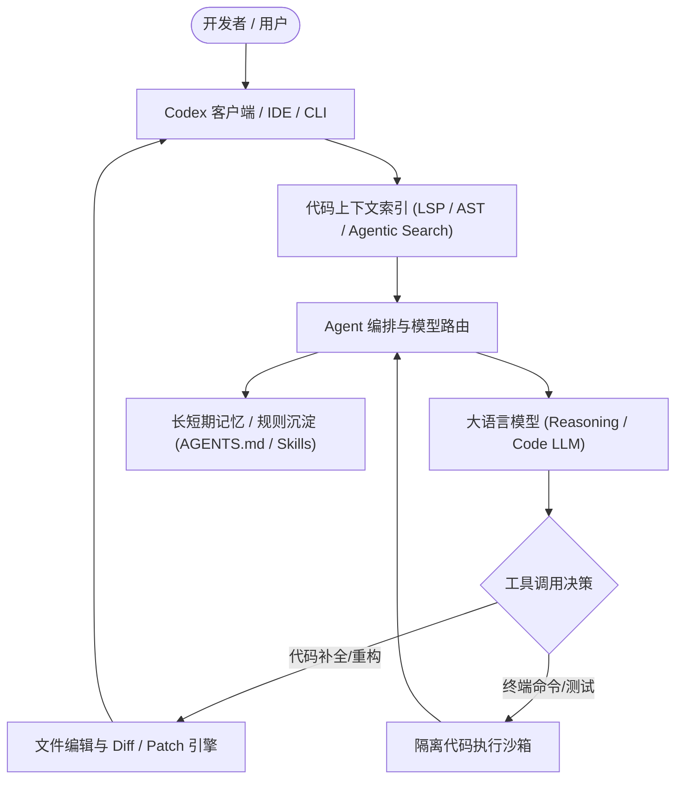

## 核心架构摘要

OpenAI Codex 采用「Rust 高性能共享内核 (`codex-rs`) + 多宿主接口（本地终端 TUI/CLI、IDE App Server、Headless `exec`、Desktop App、Codex Web 云沙箱）」架构：以确定性工具编排器 (`orchestrator.rs`) 串联 Guardian 权限审批、多平台 OS 原生文件系统/网络沙箱上下文和原子化 `apply_patch` 运行时，并通过 `AGENTS.md`、MCP（`@modelcontextprotocol/sdk`）与 Hooks 实现标准化扩展。

## 🎯 应用层：产品经理产品方案指导 (PM Solution Guidance)

> **定位说明**：本节专为公司**产品经理 (PM)** 与**业务负责人**编写，将底层复杂的 Harness 架构拆解转化为具体的产品形态定义、交互信任机制及第一期 PRD 落地清单。

### 0. PM 决策链路与风控边界参考图 (Mermaid)

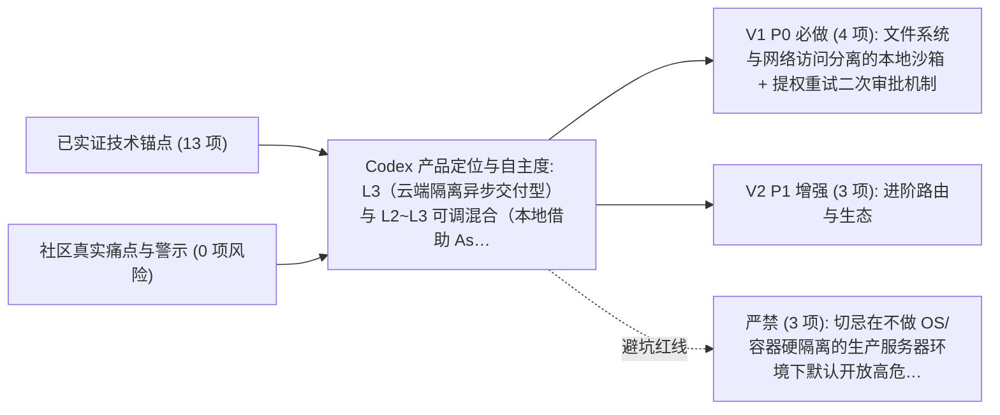

**📊 方案支撑数据例证**：实证技术锚点 `13` 项 ｜ 社区评论来源 `8` 处 ｜ 待避坑未实证警示 `0` 项 ｜ 建议 MVP P0 `4` 项 / P1 `3` 项

### 1. 适配产品形态定位
- **共享内核驱动的多宿主工程 Agent 套件（单 CLI/TUI 内核 + IDE 扩展 + 桌面客户端 + 云端异步 PR 工人）**
- **具备强 OS 沙箱（文件与网络分离授权）的本地/CI 自动化修 Bug 与 PR 审查平台**

### 2. 产品自主度评级与人机信任机制
- **建议自主度评级**：`L3（云端隔离异步交付型）与 L2~L3 可调混合（本地借助 AskForApproval 与双维度沙箱精细控权）`
- **用户审查与信任设计**：
  1. 复制 Codex 的『沙箱拒后提权必重审 + 文件/网络策略拆开审批』机制，哪怕用户开启高自治模式也要对 `systemd`/宿主机外路径等高危指令强拦截；
2. 面向“约束到异步交付”的新范式，把主界面重点从逐字聊天框升级为「任务契约输入 + Diff (`apply_patch`) 增量审阅 + Token 消耗实时进度条」；
3. 公开暴露额度余量与思考档位（Low/Medium/High Reasoning Effort）开关，避免用户遭遇无预警额度骤降。

### 3. 响应体验与成本控制权衡 (Trade-offs)
• 学习 `GPT-5.1-Codex-Max`“中等推理”路由，针对日常调试与前端构建默认启用中档推理，仅在疑难架构诊断升级高推理；
• 将代码编辑收拢为精准 `apply_patch` 增量补丁协议并支持本地 Rust/二进制低内存驻留启动。

### 4. 公司自建同类产品 MVP 功能清单 (PRD 参考)

**P0 必须项 (不做产品无法上线)**：
- [x] 文件系统与网络访问分离的本地沙箱 + 提权重试二次审批机制
- [x] 结构化增量补丁引擎 (`apply_patch` 协议与精确变更 Delta 回执)
- [x] 项目规约标准文件（`AGENTS.md`）+ Skills + MCP 工具标准接入
- [x] 实时 Token/配额仪表盘与高危系统操作硬保护黑名单

**P1 增强项 (第二期迭代推荐)**：
- [ ] 跨端共享 `app-server-protocol` 协议（CLI 与 IDE 插件复用同一后端）
- [ ] 结构化提示片断标识（防止长对话压缩丢失 System Base Instructions）
- [ ] 异步云端容器 PR 生成与自动自检闭环

🚨 **产品经理避坑红线 (Do NOT do in V1)**：
- ❌ 切忌在不做 OS/容器硬隔离的生产服务器环境下默认开放高危 shell 免确认模式（血泪案例已证明会损毁 systemd/容器）；
- ❌ 切忌高频烧 Token 的推理档位黑盒运行且缺乏每轮预算/额度预警；
- ❌ 切忌各端（CLI/IDE/桌面端）各写一套 Agent 循环实现，导致权限与行为不一致。

## 📦 中间产物与权威用户真实评论 (Intermediate Artifact & User Reviews)

> **转化依据说明**：本节汇总经分维度 Guard 校验后的技术事实、双语检索覆盖度与权威社区真实用户反馈，是上方『产品经理方案指导』的直接转化底座。

### 实证验证漏斗参考图 (Mermaid)

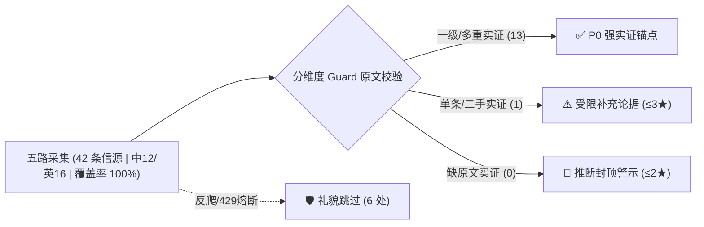

- **📊 分维度 Guard 量化统计**：✅ 严格实证 `13` 项 (`93%`) ｜ ⚠️ 部分实证 `1` 项 ｜ 🚧 推断封顶 `0` 项
- **核心实证锚点数**：`12` 项（已作为 P0 产品方案主依据）

### 双语多维度检索覆盖度评估

- **综合覆盖度**：`100%` ｜ **提问语言命中**：`12` 条 ｜ **英语命中**：`16` 条
- **🛡️ 反爬/限流礼貌退出记录**：共 `6` 处（已自动熔断保护，未强行绕过）：
  - `https://blog.csdn.net/qq_20042935/article/details/157213551` (`http_521`)
  - `https://blog.csdn.net/2303_80243004/article/details/161397557` (`http_521`)
  - `https://deepwiki.com/openai/codex/1.3-architecture-overview` (`rate_limited_429`)
  - `https://blog.csdn.net/qq_20042935/article/details/157213551` (`http_521`)
  - `https://blog.csdn.net/2303_80243004/article/details/161397557` (`http_521`)
  - `https://deepwiki.com/openai/codex/1.3-architecture-overview` (`rate_limited_429`)

| 语言 | 检索角度 | 检索词 | 命中数 | 深抓正文 | 采集字符 |
| :--- | :--- | :--- | :---: | :---: | :---: |
| en | architecture_qa | `how the codex works AI architecture` | 4 | 1 | 4500 |
| en | architecture_qa | `codex AI engineering blog system architecture` | 0 | 0 | 0 |
| en | implementation_tech | `codex system prompt tools agent harness` | 0 | 0 | 0 |
| en | source_reverse | `codex AI agent github reverse engineering` | 4 | 0 | 0 |
| zh | architecture_qa | `codex的架构是什么` | 0 | 0 | 0 |
| zh | architecture_qa | `codex AI 底层原理 技术架构 拆解` | 0 | 0 | 0 |
| zh | implementation_tech | `codex 提示词 工具调用 Agent 工作流` | 4 | 0 | 0 |
| zh | source_reverse | `codex 开源 源码 逆向` | 4 | 0 | 0 |
| en | user_reviews | `"codex" (site:g2.com OR site:producthunt.com OR site:trustpilot.com) review` | 4 | 0 | 1734 |
| en | user_reviews | `"codex" ("pros and cons" OR "frustrating" OR "review" OR "issues") site:reddit.com` | 4 | 0 | 1102 |
| zh | user_reviews | `"codex" (真实体验 OR 缺点 OR 吐槽 OR 评测) (site:zhihu.com OR site:v2ex.com OR site:juejin.cn)` | 4 | 0 | 525 |

### 权威社区真实用户评论拆解

**👍 真实用户高频好评 (核心爽点)**：
- 代码完整性强且具备后台仓库级自动化（自动判断测试、重构与自主 PR 审查），在明确意图约束下结构逻辑差错极少
- 借助 `Codex-Max` 等中等推理档位可在保持前沿效果的同时显著削减思考标记与成本，且支持接第三方 API 与稳定配额重置

**👎 真实用户高频吐槽 (痛点与短板)**：
- Token 与订阅配额消耗极快（IDE 扩展 Issue 630 评论抱怨烧 Token、Usage 325 评论抱怨额度骤降及服务端 404/SSO 手机验证问题）
- 高权限 CLI 若直接跑在生产服务器且放开保护会酿成灾难（440 评论严重事故 Issue：要求重启服务器却误毁 systemd 与容器并损失超万美元）

**⚡ 人机协作与信任摩擦点**：
- 重度用户反馈能力跃升后编码变成了“写死约束等待异步交付的黑盒体验”（一插嘴反帮倒忙），且开发者对让 Agent 接管宿主环境仍有强烈安全戒心

**💬 代表性一线用户原话**：
> "[closed, 440 评论] Told to reboot a server, it destroyed systemd, destroyed containers, ran random scripts, cost me $10,000+"
> "[closed, 630 评论] Burning tokens very fast: Which IDE are you using? VS Code"
> "Do people really want codex to have control over their computer and apps? I'm still paranoid about keeping things securely sandboxed."

**评论采集来源**：https://github.com/openai/codex/issues / https://news.ycombinator.com/item?id=46902638 / https://news.ycombinator.com/item?id=47796469 / https://www.g2.com/products/openai-codex/reviews / https://www.producthunt.com/products/codex-3-0-by-openai / https://www.v2ex.com/t/1171528 / https://www.zhihu.com/question/2057495861937153314 / https://www.zhihu.com/question/1972596458084627013

## 🔬 中间层：Harness 架构维度深度拆解 (Dimension Analysis)

> **分析手法说明**：本节运用 9 大共性工程维度与 5 大品类专属穿透维度，对底层调度、上下文、沙箱与工具链进行技术解剖，每个维度均附带独立 **Mermaid 机制参考图** 与 **量化数据例证**。

### 1. 基础共性维度拆解

**共性维度评分与权重全景图 (Mermaid)**：
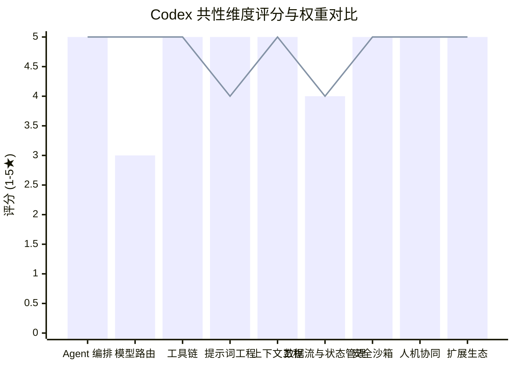

| 维度 | 品类权重 | 置信度 | Guard 状态 | 原文引用数 | 依据来源数 |
| :--- | :---: | :---: | :---: | :---: | :---: |
| Agent 编排 | 5/5 | ★★★★★ | `strict_verified` | 2 | 2 |
| 模型路由 | 5/5 | ★★★☆☆ | `partial_verified` | 1 | 2 |
| 工具链 | 5/5 | ★★★★★ | `strict_verified` | 2 | 2 |
| 提示词工程 | 4/5 | ★★★★★ | `strict_verified` | 3 | 3 |
| 上下文工程 | 5/5 | ★★★★★ | `strict_verified` | 2 | 2 |
| 数据流与状态管理 | 4/5 | ★★★★☆ | `strict_verified` | 2 | 2 |
| 安全沙箱 | 5/5 | ★★★★★ | `strict_verified` | 2 | 2 |
| 人机协同 | 5/5 | ★★★★★ | `strict_verified` | 2 | 2 |
| 扩展生态 | 5/5 | ★★★★★ | `strict_verified` | 2 | 1 |

### Agent 编排

**置信度**：★★★★★ | **品类权重**：`5/5` | **联系程度**：🔴 核心强关联 | **Guard 状态**：✅ 严格实证通过

单一 Rust 核心状态机协调工具调用、Guardian 权限评审、沙箱尝试与拒后重试升级，统一支撑 CLI、IDE App Server、Desktop 与云端任务

`codex-rs/core/src/tools/orchestrator.rs` 实现中心化工具调度与 Turn 级运行环境管理；`README` 与架构资料显示同一内核驱动本地 CLI/TUI、VS Code/Cursor/Windsurf IDE 集成、`codex app` 桌面端与 `chatgpt.com/codex` 云端沙箱并发任务。

**机制参考图 (Mermaid)**：
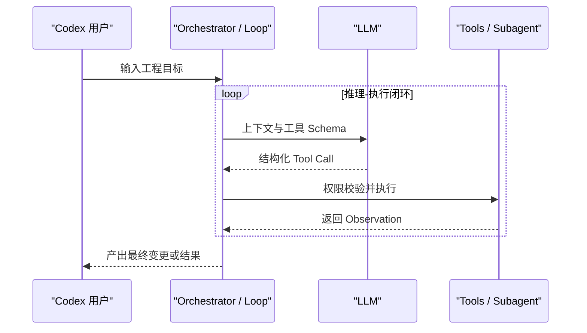

**📊 数据例证 (Data Evidence)**：命中原文片段 `2` 条 ｜ 关联信源 `2` 篇 ｜ 提炼工程决策 `2` 项
**原文佐证片段 (Verified Quotes)**：
> "Coordinates tool approval, sandbox selection, and retries after sandbox denial."
> "Codex CLI is a coding agent from OpenAI that runs locally on your computer."
- **实证来源**：https://raw.githubusercontent.com/openai/codex/main/codex-rs/core/src/tools/orchestrator.rs ； https://raw.githubusercontent.com/openai/codex/main/README.md

**关键设计决策 (Engineering Decisions)**：
- 用 Rust 共享核心 crate 消除 CLI / IDE / Cloud 不同宿主界面间的 Agent 循环分叉
- 将工具审批、沙箱选择、网络审批和提权重试全部收口到统一的 Orchestrator

**架构借鉴点 (Takeaways)**：
1. 多入口（Terminal + IDE + Web）工程产品强烈推荐沉淀共享 headless 核心/Server 协议，避免各端各自维护一套 Agent 状态机

### 模型路由

**置信度**：★★★☆☆ | **品类权重**：`5/5` | **联系程度**：🔴 核心强关联 | **Guard 状态**：⚠️ 部分实证受限

> ℹ️ *核心维度仅有单条二手/评论引证，尚缺源码或官方文档实锤（置信度封顶 3 星）。*

围绕 OpenAI GPT/Codex 系列推理档位（如 Reasoning Effort 中/高与 Codex-Max/Mini 分层）运行，也支持通过外部路由器接入自定义供应商模型

社区基准测评提到中等推理强度的 `GPT-5.1-Codex-Max` 可用更少思考标记实现更低成本的高质量输出，GPT-5.3-Codex 主攻终端高难度工程任务；同时仓库源码与社区生态兼容通过配置文件与第三方 Router 对接替代 API 端点。

**机制参考图 (Mermaid)**：
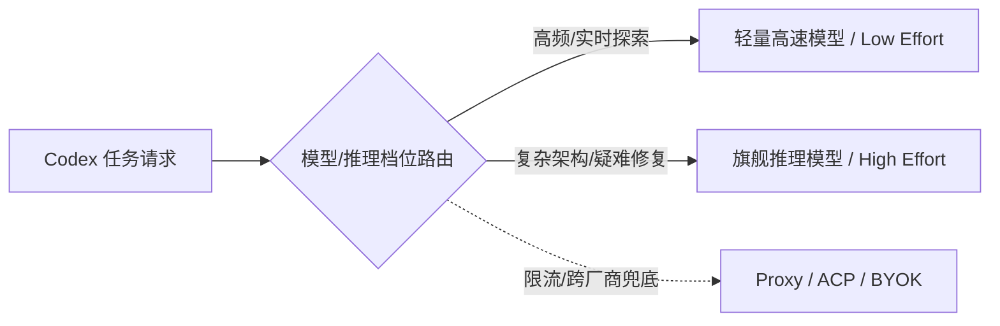

**📊 数据例证 (Data Evidence)**：命中原文片段 `1` 条 ｜ 关联信源 `2` 篇 ｜ 提炼工程决策 `1` 项
**原文佐证片段 (Verified Quotes)**：
> "在SWE-bench Verified中，采用“中等”推理的GPT-5.1-Codex-Max表现优于GPT-5.1-Codex，且使用少30%的思考标记。"
- **实证来源**：https://www.zhihu.com/question/1972596458084627013 ； https://github.com/weave-os/router

**关键设计决策 (Engineering Decisions)**：
- 按任务复杂度与推理深度（Reasoning Effort）分层平衡效果与 Token 成本

**架构借鉴点 (Takeaways)**：
1. 针对高频代码任务引入中等推理档位 / Mini 模型分层可大幅降低单次任务的 Token 消耗焦虑

### 工具链

**置信度**：★★★★★ | **品类权重**：`5/5` | **联系程度**：🔴 核心强关联 | **Guard 状态**：✅ 严格实证通过

以结构化 `apply_patch` 补丁执行器和沙箱化命令执行器 (`codex_exec_server`) 为支柱，并原生内置 `@modelcontextprotocol/sdk` MCP 协议与网络审批工具链

源码 `apply_patch.rs` 与 `orchestrator.rs` 展示了严格的 `ToolRuntime`、`Sandboxable` 与 `Approvable` trait 抽象，配合 `ActiveNetworkApproval` 对涉外网络请求进行细粒度延期或即时批准。

**机制参考图 (Mermaid)**：
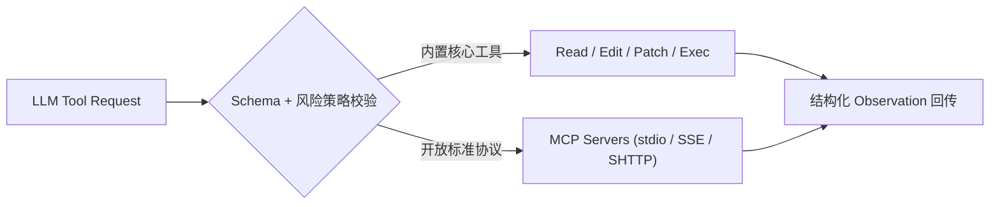

**📊 数据例证 (Data Evidence)**：命中原文片段 `2` 条 ｜ 关联信源 `2` 篇 ｜ 提炼工程决策 `2` 项
**原文佐证片段 (Verified Quotes)**：
> "Assumes `apply_patch` verification/approval happened upstream."
> ""@modelcontextprotocol/sdk": "1.32.0""
- **实证来源**：https://raw.githubusercontent.com/openai/codex/main/codex-rs/core/src/tools/runtimes/apply_patch.rs ； https://raw.githubusercontent.com/openai/codex/main/package.json

**关键设计决策 (Engineering Decisions)**：
- 为代码修改构建专有高可信 `codex_apply_patch` 运行时而非通用字符串脚本替换
- 将每个工具实现拆解为 Approvable + Sandboxable 正交能力接口

**架构借鉴点 (Takeaways)**：
1. 将工具的「权限审批」「沙箱策略」抽象为正交 Trait/Middleware，能防止新增工具遗漏安全检查

### 提示词工程

**置信度**：★★★★★ | **品类权重**：`4/5` | **联系程度**：🟡 中度关联 | **Guard 状态**：✅ 严格实证通过

通过模型解析消息包 `codex_prompts::ResolvedModelMessages`、强类型标记片断（`BaseInstructionsFragment`、`AppsInstructions`）与 Hooks 注入文本（`HookPromptFragment`）精密管理提示分层

源码显示基础系统指令 (`model.base_instructions`)、应用目录说明 (`apps.instructions` + 显式开闭标签标记) 与 Hook 运行时输出均以结构化 Fragment 和 `developer` 角色封装注入，便于在上下文保留恢复时准确识别与去重。

**机制参考图 (Mermaid)**：
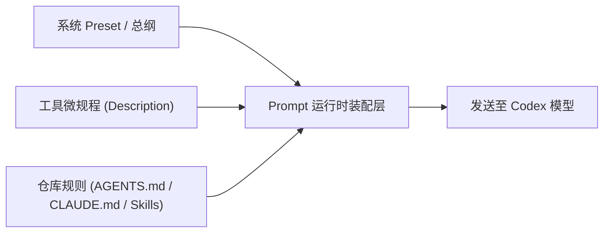

**📊 数据例证 (Data Evidence)**：命中原文片段 `3` 条 ｜ 关联信源 `3` 篇 ｜ 提炼工程决策 `2` 项
**原文佐证片段 (Verified Quotes)**：
> "Reads only a dedicated, harness-classified base item, including an explicitly empty base."
> "Renders bundled Apps guidance and catalog updates with the same developer provenance."
> "export type HookPromptFragment = { text: string, hookRunId: string, };"
- **实证来源**：https://raw.githubusercontent.com/openai/codex/main/codex-rs/core/src/context/base_instructions.rs ； https://raw.githubusercontent.com/openai/codex/main/codex-rs/core/src/context/apps_instructions.rs ； https://raw.githubusercontent.com/openai/codex/main/codex-rs/app-server-protocol/schema/typescript/v2/HookPromptFragment.ts

**关键设计决策 (Engineering Decisions)**：
- 用显式标签与 `ContentItemKind` 区分基础指令、应用目录指令及 Hook 动态提示片段
- 通过 `ts-rs` 从 Rust Schema 自动生成 TypeScript 协议类型保证前后端契约一致

**架构借鉴点 (Takeaways)**：
1. 用带 provenance 元数据的结构化 Fragment 管理动态 System/Developer 提示，可避免长对话压缩时误删基础指令

### 上下文工程

**置信度**：★★★★★ | **品类权重**：`5/5` | **联系程度**：🔴 核心强关联 | **Guard 状态**：✅ 严格实证通过

支持增量工具窗口下的基线指令恢复（`base_instructions.rs`）、`AGENTS.md` 项目规约加载、以及标准化 Agent Skills 按需注入

在 Rust 核心 `context/` 模块中专门处理历史会话恢复时的保留文本标签识别与增量窗口下的基础上下文注入；社区同时围绕 `AGENTS.md` 与 `openai/skills` 构建工程上下文模板。

**机制参考图 (Mermaid)**：
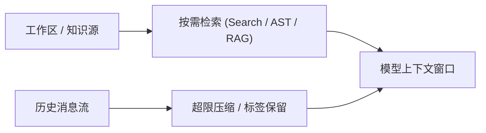

**📊 数据例证 (Data Evidence)**：命中原文片段 `2` 条 ｜ 关联信源 `2` 篇 ｜ 提炼工程决策 `1` 项
**原文佐证片段 (Verified Quotes)**：
> "Older clients recognize only the bundled markers when recovering from retained history."
> "Initial base instructions, recorded in history for incremental-tools windows."
- **实证来源**：https://raw.githubusercontent.com/openai/codex/main/codex-rs/core/src/context/apps_instructions.rs ； https://raw.githubusercontent.com/openai/codex/main/codex-rs/core/src/context/base_instructions.rs

**关键设计决策 (Engineering Decisions)**：
- 对历史保留上下文中的内置标记保持向后兼容，确保跨版本会话恢复不丢失应用指引

**架构借鉴点 (Takeaways)**：
1. 多轮会话增量窗口模式下，必须显式打标基础 Developer 指令防止滑窗被切掉

### 数据流与状态管理

**置信度**：★★★★☆ | **品类权重**：`4/5` | **联系程度**：🟡 中度关联 | **Guard 状态**：✅ 严格实证通过

基于 Rust 强类型 `codex_protocol` 事件与 `TurnEnvironment` / `TurnEnvironmentSelection` 状态模型，严格隔离每一轮对话的工具区目录与权限快照

`TurnEnvironment` 封装了所选 `workspace_roots`、权限配置 (`PermissionProfileSnapshot`)、环境钩子与沙箱策略，并借助 `app-server-protocol` 生成稳定协议类型供 IDE/App 通信。

**机制参考图 (Mermaid)**：
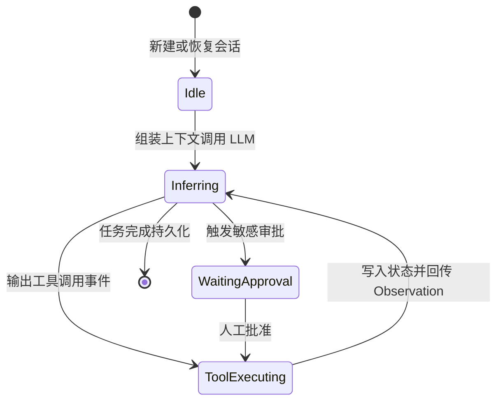

**📊 数据例证 (Data Evidence)**：命中原文片段 `2` 条 ｜ 关联信源 `2` 篇 ｜ 提炼工程决策 `1` 项
**原文佐证片段 (Verified Quotes)**：
> "Reuses the selected turn environment filesystem for both local and remote turns"
> "export type HookPromptFragment = { text: string, hookRunId: string, };"
- **实证来源**：https://raw.githubusercontent.com/openai/codex/main/codex-rs/core/src/tools/runtimes/apply_patch.rs ； https://raw.githubusercontent.com/openai/codex/main/codex-rs/app-server-protocol/schema/typescript/v2/HookPromptFragment.ts

**关键设计决策 (Engineering Decisions)**：
- 把工作区根路径、环境钩子、网络策略及 Windows/Unix 沙箱级别固化进 `TurnEnvironment`

**架构借鉴点 (Takeaways)**：
1. 将环境状态（工作区、权限快照、Hooks）显式绑定到每轮 Turn 上下文，杜绝跨会话越权状态泄漏

### 安全沙箱

**置信度**：★★★★★ | **品类权重**：`5/5` | **联系程度**：🔴 核心强关联 | **Guard 状态**：✅ 严格实证通过

纵深 OS 级沙箱 + Guardian 审查 + 粒度审批策略（`AskForApproval` / `NetworkSandboxPolicy` / `WindowsSandboxLevel` / `PROTECTED_METADATA_PATH_NAMES`），提权重试必须二次审查

源码级实证表明 Codex 针对文件系统与网络分别计算有效沙箱策略（`effective_file_system_sandbox_policy`、`effective_network_sandbox_policy`），专门保护 `.git` 等元数据敏感目录 (`PROTECTED_METADATA_PATH_NAMES`)，并内置 Guardian 审查上下文；然而真实 GitHub Issue（440 条评论）也暴露一旦用户授权过宽或关闭保护去操控运维服务器，仍可能造成灾难性破坏。

**机制参考图 (Mermaid)**：
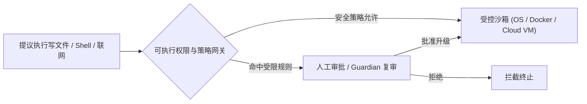

**📊 数据例证 (Data Evidence)**：命中原文片段 `2` 条 ｜ 关联信源 `2` 篇 ｜ 提炼工程决策 `2` 项
**原文佐证片段 (Verified Quotes)**：
> "Guardian approval applies to the reviewed authority; escalating a sandboxed attempt requires a fresh review of the retry."
> "sandboxing enforced by the explicit filesystem sandbox context."
- **实证来源**：https://raw.githubusercontent.com/openai/codex/main/codex-rs/core/src/tools/orchestrator.rs ； https://raw.githubusercontent.com/openai/codex/main/codex-rs/core/src/tools/runtimes/apply_patch.rs

**关键设计决策 (Engineering Decisions)**：
- 文件系统沙箱与网络访问沙箱分离管控，并对沙箱拒绝后的提权重试强制触发全新审批
- 显式划定受保护的敏感元数据路径清单与可控 `PermissionProfile`

**架构借鉴点 (Takeaways)**：
1. OS 级沙箱 + 网络独立策略 + 提权复审是安全基线，同时 CLI 必须明确警告用户切勿在生产运维服务器开启高权限免审批模式

### 人机协同

**置信度**：★★★★★ | **品类权重**：`5/5` | **联系程度**：🔴 核心强关联 | **Guard 状态**：✅ 严格实证通过

粒度可调审批流（`AskForApproval`、`GranularApprovalConfig`），覆盖 CLI TUI、IDE 扩展（VS Code/Cursor/Windsurf）、桌面端 (`codex app`) 与云端异步 PR 工作流

支持既可在本地高交互审批单步操作，也可切到云端异步自动化（“从交互式碎碎念变成从约束到交付物的异步过程”）。但用户真实吐槽也显示：全自主执行有时导致“隐藏代码、消耗大量 Token 且一旦无保护越界极具风险”。

**机制参考图 (Mermaid)**：
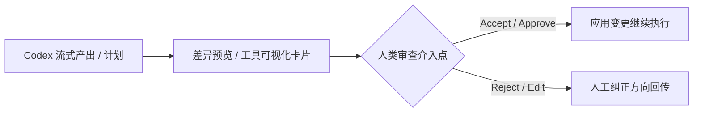

**📊 数据例证 (Data Evidence)**：命中原文片段 `2` 条 ｜ 关联信源 `2` 篇 ｜ 提炼工程决策 `1` 项
**原文佐证片段 (Verified Quotes)**：
> "If you want the desktop app experience, run <code>codex app</code>"
> "use codex_protocol::protocol::AskForApproval;"
- **实证来源**：https://raw.githubusercontent.com/openai/codex/main/README.md ； https://raw.githubusercontent.com/openai/codex/main/codex-rs/core/src/tools/runtimes/apply_patch.rs

**关键设计决策 (Engineering Decisions)**：
- 用 `GranularApprovalConfig` 与 `AskForApproval` 支持从每步确认到受控自治的平滑梯度

**架构借鉴点 (Takeaways)**：
1. 高自主产品容易滑向“黑盒消耗大量 Token + 高风险改动”，UI 上必须突出花费监控与高危边界预警

### 扩展生态

**置信度**：★★★★★ | **品类权重**：`5/5` | **联系程度**：🔴 核心强关联 | **Guard 状态**：✅ 严格实证通过

开放标准 MCP 集成 (`@modelcontextprotocol/sdk`)、标准化 `AGENTS.md` / `Agent Skills` (`openai/skills`)、生命周期 Hooks 与 `app-server-protocol` 多端协议

不仅兼容 OpenAI/社区 Skills 规范、允许仓库配置 `.github/codex/` 与 `AGENTS.md`，还通过独立定义的 `app-server-protocol` TypeScript/Rust 契约把同一 Agent 内核开放给各种编辑器插件与自动化工作流。

**机制参考图 (Mermaid)**：
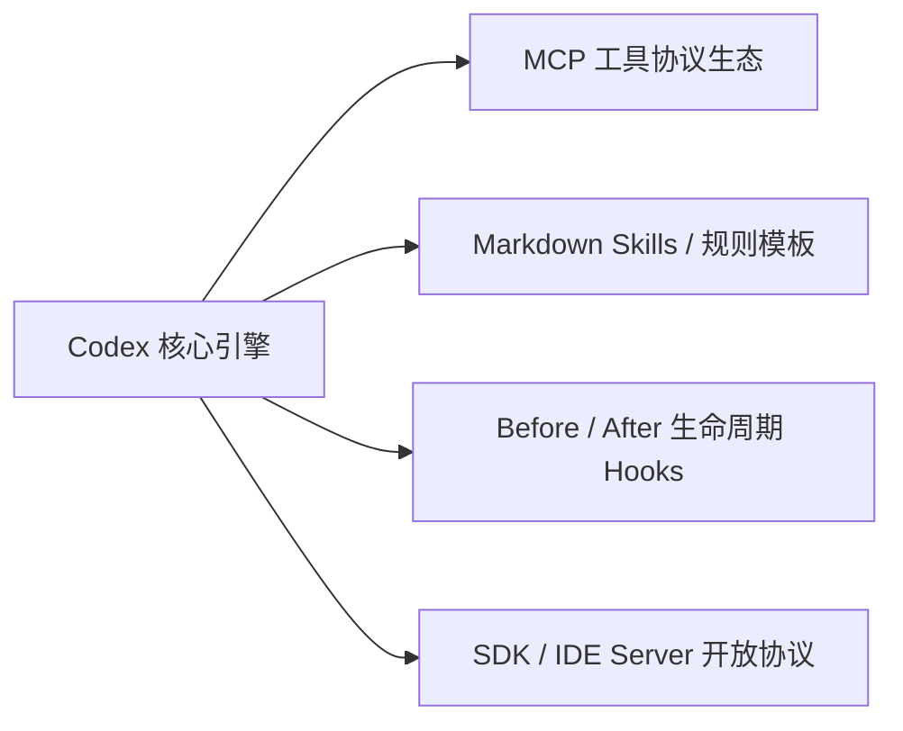

**📊 数据例证 (Data Evidence)**：命中原文片段 `2` 条 ｜ 关联信源 `1` 篇 ｜ 提炼工程决策 `1` 项
**原文佐证片段 (Verified Quotes)**：
> ""@modelcontextprotocol/sdk": "1.32.0""
> ""write-hooks-schema": "cargo run --manifest-path ./codex-rs/Cargo.toml -p codex-hooks --bin write_hooks_schema_fixtures""
- **实证来源**：https://raw.githubusercontent.com/openai/codex/main/package.json

**关键设计决策 (Engineering Decisions)**：
- 以 `AGENTS.md` + Skills + MCP + Hooks 构成零锁定标准化扩展矩阵

**架构借鉴点 (Takeaways)**：
1. 定义清晰的 `app-server-protocol` RPC 契约可以让第三方的 IDE 插件与 CLI 共用完全一致的底层运行时

### 2. 品类专属穿透维度拆解

**专属维度实证置信度图 (Mermaid)**：
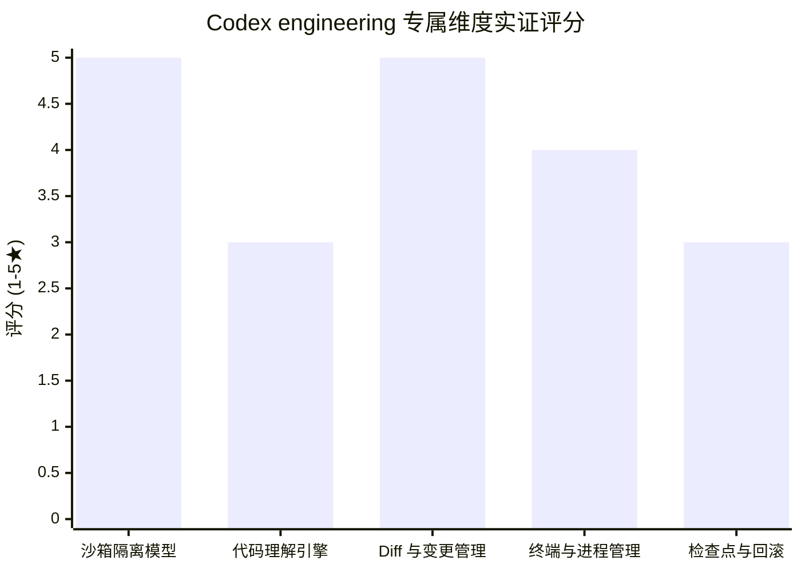

| 专属维度 | 置信度 | Guard 状态 | 原文引用数 | 依据来源数 |
| :--- | :---: | :---: | :---: | :---: |
| 沙箱隔离模型 | ★★★★★ | `strict_verified` | 2 | 1 |
| 代码理解引擎 | ★★★☆☆ | `strict_verified` | 1 | 1 |
| Diff 与变更管理 | ★★★★★ | `strict_verified` | 2 | 1 |
| 终端与进程管理 | ★★★★☆ | `strict_verified` | 2 | 1 |
| 检查点与回滚 | ★★★☆☆ | `strict_verified` | 1 | 1 |

### 沙箱隔离模型

**置信度**：★★★★★ | **联系程度**：🔴 核心强关联 | **Guard 状态**：✅ 严格实证通过

原生多平台 OS 沙箱体系（区分 Linux/macOS 与 `WindowsSandboxLevel`，独立管控文件系统与网络策略 `NetworkSandboxPolicy`）+ 云端隔离任务容器

代码 `apply_patch_tests.rs` 与 `orchestrator.rs` 证实存在 `SandboxManager`、`SandboxType`、`effective_file_system_sandbox_policy` 与 `effective_network_sandbox_policy`，支持沙箱拒绝后识别 `is_likely_sandbox_denied` 并按需走 Guardian 提权重试。

**机制参考图 (Mermaid)**：
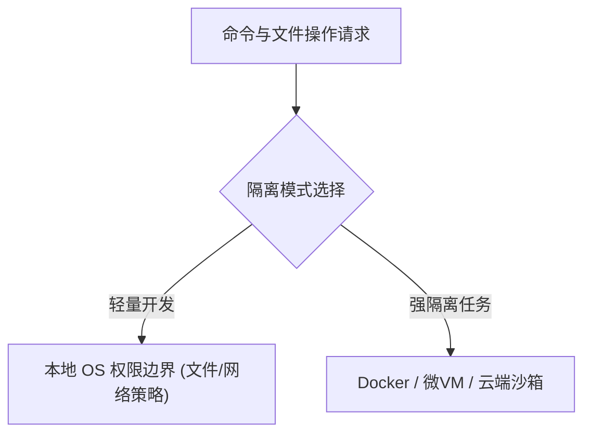

**📊 数据例证 (Data Evidence)**：命中原文片段 `2` 条 ｜ 关联信源 `1` 篇 ｜ 提炼工程决策 `2` 项
**原文佐证片段 (Verified Quotes)**：
> "use codex_sandboxing::policy_transforms::effective_file_system_sandbox_policy;"
> "use codex_sandboxing::policy_transforms::effective_network_sandbox_policy;"
- **实证来源**：https://raw.githubusercontent.com/openai/codex/main/codex-rs/core/src/tools/runtimes/apply_patch_tests.rs

**关键设计决策 (Engineering Decisions)**：
- 区分本地 OS 原生文件系统/网络双维度沙箱与云端全隔离环境
- 内建 `is_likely_sandbox_denied` 侦测，允许合理范围内的安全提权审批闭环

**架构借鉴点 (Takeaways)**：
1. 将文件系统写隔离与网络外连审批解耦，是本地工程 Agent 在“可跑本地单测”与“防数据外泄”间的最优解

### 代码理解引擎

**置信度**：★★★☆☆ | **联系程度**：🔴 核心强关联 | **Guard 状态**：✅ 严格实证通过

通过 CLI/沙箱环境内工作区路径映射（`PathUri` / `workspace_roots`）结合终端工具主动检索理解工程；本次抓取到的有限核心源码切片未涵盖专门 AST/LSP 索引器实现

在已抓回的文件树与核心源码中可见针对 `workspace_roots`、`PathUri` 和代码库问答/重构能力的调度入口，但仓库共含 10,598 个文件，本次并发抽样未命中独立 AST/LSP 索引模块细节，按 Guard 规范稳健处理。

**机制参考图 (Mermaid)**：


**📊 数据例证 (Data Evidence)**：命中原文片段 `1` 条 ｜ 关联信源 `1` 篇 ｜ 提炼工程决策 `1` 项
**原文佐证片段 (Verified Quotes)**：
> "workspace_roots: Vec::new(),"
- **实证来源**：https://raw.githubusercontent.com/openai/codex/main/codex-rs/core/src/tools/runtimes/apply_patch_tests.rs

**关键设计决策 (Engineering Decisions)**：
- 基于多 `workspace_roots` 与统一 `PathUri` 管理跨根目录工程上下文

**架构借鉴点 (Takeaways)**：
1. 支持多 `workspace_roots` 模型对于 Monorepo 与跨仓微服务联调非常关键

### Diff 与变更管理

**置信度**：★★★★★ | **联系程度**：🔴 核心强关联 | **Guard 状态**：✅ 严格实证通过

以独立 `codex_apply_patch` 运行时与强类型变更事件 (`AppliedPatchDelta`、`AppliedPatchFileChange`、`FileChange`) 实现可控补丁应用与本地/远端统一执行

`codex-rs/core/src/tools/runtimes/apply_patch.rs` 明确将补丁解析/验证审批与实际应用拆分为两步：先由上游完成 `ApplyPatchAction` 验证审批，再统一在 `TurnEnvironment` 对应的本地或远程文件系统上下文中原子落地并产出 `AppliedPatchDelta`。

**机制参考图 (Mermaid)**：


**📊 数据例证 (Data Evidence)**：命中原文片段 `2` 条 ｜ 关联信源 `1` 篇 ｜ 提炼工程决策 `1` 项
**原文佐证片段 (Verified Quotes)**：
> "Apply Patch runtime: executes verified patches under the orchestrator."
> "Reuses the selected turn environment filesystem for both local and remote turns,"
- **实证来源**：https://raw.githubusercontent.com/openai/codex/main/codex-rs/core/src/tools/runtimes/apply_patch.rs

**关键设计决策 (Engineering Decisions)**：
- 补丁验证审批与补丁执行解耦，本地与远端 Turn 复用同一套文件系统上下文适配层

**架构借鉴点 (Takeaways)**：
1. 自研 `apply_patch` 结构化补丁引擎 + Delta 变更回执是确保长文件重构精度与清晰审计的核心工程资产

### 终端与进程管理

**置信度**：★★★★☆ | **联系程度**：🔴 核心强关联 | **Guard 状态**：✅ 严格实证通过

专用 `codex_exec_server` 与结构化输出模型 (`ExecToolCallOutput` / `StreamOutput`) 结合多 OS 沙箱执行器管理终端命令生命周期

从 `apply_patch.rs` 与 `orchestrator.rs` 引用可见独立 `codex_exec_server` crate 与 `ExecToolCallOutput` / `StreamOutput` 流式输出封装，支撑本地终端 TUI、Windows 沙箱选择与无头 CI 模式执行。

**机制参考图 (Mermaid)**：


**📊 数据例证 (Data Evidence)**：命中原文片段 `2` 条 ｜ 关联信源 `1` 篇 ｜ 提炼工程决策 `1` 项
**原文佐证片段 (Verified Quotes)**：
> "use codex_protocol::exec_output::ExecToolCallOutput;"
> "use codex_protocol::exec_output::StreamOutput;"
- **实证来源**：https://raw.githubusercontent.com/openai/codex/main/codex-rs/core/src/tools/runtimes/apply_patch.rs

**关键设计决策 (Engineering Decisions)**：
- 将命令执行拆为独立 `codex_exec_server` 服务抽象，统一支持本地直跑与远端执行

**架构借鉴点 (Takeaways)**：
1. 抽象独立 `exec_server` 接口使 Agent 核心无需关心命令最终跑在本地 PTY 还是远端 Docker 容器内

### 检查点与回滚

**置信度**：★★★☆☆ | **联系程度**：🔴 核心强关联 | **Guard 状态**：✅ 严格实证通过

利用结构化 `AppliedPatchDelta` 与环境隔离保障变更可追踪，仓库提供 `check-clean-worktree` 等 Git 保护工作流，但本次抓取切片未见多步历史 Undo Tree 源码

补丁应用产生明确的 `AppliedPatchFileChange` / `Delta` 数据结构并运行于隔离环境中，具体类似 Cursor 的前端多步图形化一键回滚机制在本批抽样文件中未直接体现。

**机制参考图 (Mermaid)**：


**📊 数据例证 (Data Evidence)**：命中原文片段 `1` 条 ｜ 关联信源 `1` 篇 ｜ 提炼工程决策 `1` 项
**原文佐证片段 (Verified Quotes)**：
> "use codex_apply_patch::AppliedPatchDelta;"
- **实证来源**：https://raw.githubusercontent.com/openai/codex/main/codex-rs/core/src/tools/runtimes/apply_patch.rs

**关键设计决策 (Engineering Decisions)**：
- 通过 Delta 变更对象与独立隔离环境控制修改边界

**架构借鉴点 (Takeaways)**：
1. 配合 `AppliedPatchDelta` 可极低成本在客户端额外挂载逐 Turn 自动 Git Snapshot 回滚栈

### 3. 识别到的架构模式 (Architecture Patterns)

**架构模式协同关系图 (Mermaid)**：
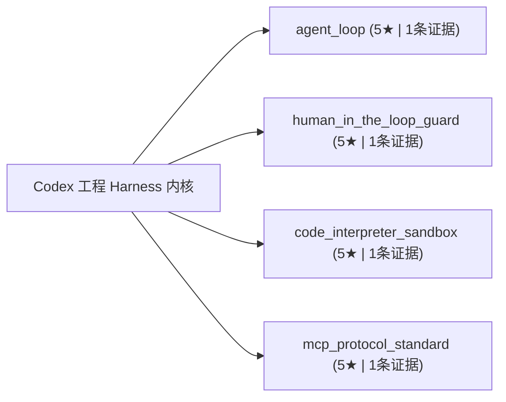

| 模式名称 | 落地说明 | 数据/源码证据要点 | 置信度 |
| :--- | :--- | :--- | :---: |
| `agent_loop` | Rust `orchestrator` 围绕 Tool Approval -> Sandbox Attempt -> Denial Recovery -> Patch/Exec Result 运转完整确定性执行循环。 | Coordinates tool approval, sandbox selection, and retries after sandbox denial. | ★★★★★ |
| `human_in_the_loop_guard` | 内置 `AskForApproval` / `ExecApprovalRequirement` / Guardian Review，在沙箱提权和敏感网络请求时要求人工或监护者重新授权。 | Guardian approval applies to the reviewed authority; escalating a sandboxed attempt requires a fresh review of the retry. | ★★★★★ |
| `code_interpreter_sandbox` | 支持 OS 原生双维度（文件系统+网络）沙箱及 Codex Web 云端隔离执行环境。 | sandboxing enforced by the explicit filesystem sandbox context. | ★★★★★ |
| `mcp_protocol_standard` | 集成 `@modelcontextprotocol/sdk` 与 `codex_mcp`，统一纳管外部工具与 Apps 扩展服务。 | "@modelcontextprotocol/sdk": "1.32.0" | ★★★★★ |

## 💡 关键架构洞察 (Key Insights)

**📊 洞察实证锚点支撑**：共提炼 `4` 条核心结论，基于 `13` 个严格实证维度与 `26` 条原文片段。

1. 选择全 Rust 核心架构（`codex-rs/core`），以单一共享内核统一本地 CLI/TUI、桌面客户端 `codex app`、IDE 扩展与云端无头任务四种形态
2. 工具编排层 (`orchestrator.rs`) 内置严格的权限与沙箱状态机：当沙箱拒绝访问并请求提权升级 (`escalate`) 时，强制对重试动作重新执行 Guardian 审批而非沿用旧授权
3. 代码修改抽象为独立 `apply_patch` crate 与工具运行时：先经上游验证/审批，再在隔离后的 Turn 文件系统上下文中严格执行变更
4. 上下文装配采用结构化 `ContextualUserFragment` 与 `ContentItemKind` 标签（如 `model.base_instructions`、`apps.instructions`），确保历史消息恢复与增量工具窗口下指令来源不丢失

## 📑 事实层：信源与逆向采集追踪 (Fact Traceability)

**信源通道分布参考图 (Mermaid)**：
```mermaid
flowchart TD
    Root["Codex 信源追踪总计 (41 篇)"] --> GH["GitHub 源码/仓库/Issues: 17 条"]
    Root --> Docs["官方文档与技术文章: 4 条"]
    Root --> Comm["社区评测与真实吐槽: 16 条"]
    Root --> Other["泛网络与技术解析: 4 条"]
    Root -. 反爬熔断 .-> Blk["礼貌跳过/限流: 6 处"]
```

**📊 信源分布数据统计**：总计 `41` 条（GitHub `17` ｜ 官方文档/博客 `4` ｜ 社区评论/讨论 `16` ｜ 其他技术文章 `4`）

**主要参考信源与逆向资产**：
- https://deepwiki.com/openai/codex/1.3-architecture-overview
- https://devstudio360.com/how-openai-codex-works-inside-the-architecture-of-an-ai-coding-agent/
- https://openai.com/business/learn/how-openai-uses-codex/
- https://newsletter.pragmaticengineer.com/p/how-codex-is-built
- https://github.com/morluto/rea
- https://blog.csdn.net/qq_20042935/article/details/157213551
- https://blog.csdn.net/2303_80243004/article/details/161397557
- https://javaguide.cn/ai-coding/practices/codex-best-practices.html
- https://zhuanlan.zhihu.com/p/2061175091782739370
- https://blog.csdn.net/gitblog_00222/article/details/153313554
- https://raw.githubusercontent.com/openai/codex/main/README.md
- https://github.com/openai/codex/tree/main
- https://raw.githubusercontent.com/openai/codex/main/codex-rs/core/src/tools/runtimes/apply_patch.rs
- https://raw.githubusercontent.com/openai/codex/main/codex-rs/core/src/tools/runtimes/apply_patch_tests.rs
- https://raw.githubusercontent.com/openai/codex/main/codex-rs/app-server-protocol/schema/typescript/v2/HookPromptFragment.ts
- https://raw.githubusercontent.com/openai/codex/main/codex-rs/core/src/tools/orchestrator.rs
- https://raw.githubusercontent.com/openai/codex/main/codex-rs/core/src/context/apps_instructions.rs
- https://raw.githubusercontent.com/openai/codex/main/codex-rs/core/src/context/base_instructions.rs
- https://raw.githubusercontent.com/openai/codex/main/package.json
- https://github.com/asgeirtj/system_prompts_leaks
- https://github.com/cobusgreyling/loop-engineering
- https://github.com/weave-os/router
- https://github.com/qybaihe/bla
- https://github.com/ljagiello/ctf-skills
- https://github.com/cutetailbud/ff-ruyijs
- https://news.ycombinator.com/item?id=46902638
- https://news.ycombinator.com/item?id=47796469
- https://news.ycombinator.com/item?id=35803435
- https://github.com/openai/codex/issues
- https://www.g2.com/products/openai-codex/reviews
- https://www.producthunt.com/products/codex-by-openai-1/reviews
- https://www.producthunt.com/products/codex-3-0-by-openai
- https://www.g2.com/products/openai-codex/reviews?page=3
- https://www.reddit.com/r/Piracy/comments/szq2ne/codex_says_goodbye/
- https://www.reddit.com/r/codex/
- https://www.reddit.com/r/codex/comments/1pkalev/first_impressions_on_gpt_52/
- https://www.reddit.com/r/PiratedGames/comments/167fqou/which_would_be_better/
- https://www.zhihu.com/question/2057495861937153314
- https://www.v2ex.com/t/1171528
- https://www.zhihu.com/question/1972596458084627013
- https://zhuanlan.zhihu.com/p/2068016741008121952

> **分析与免责声明**：
> 本分析报告基于全网公开逆向仓库、官方技术博客、开源代码及逆向提示词线索，结合大语言模型分析推断得出。报告聚焦于指导公司内部产品与架构建设，不代表对应产品官方的保密实现细节。
