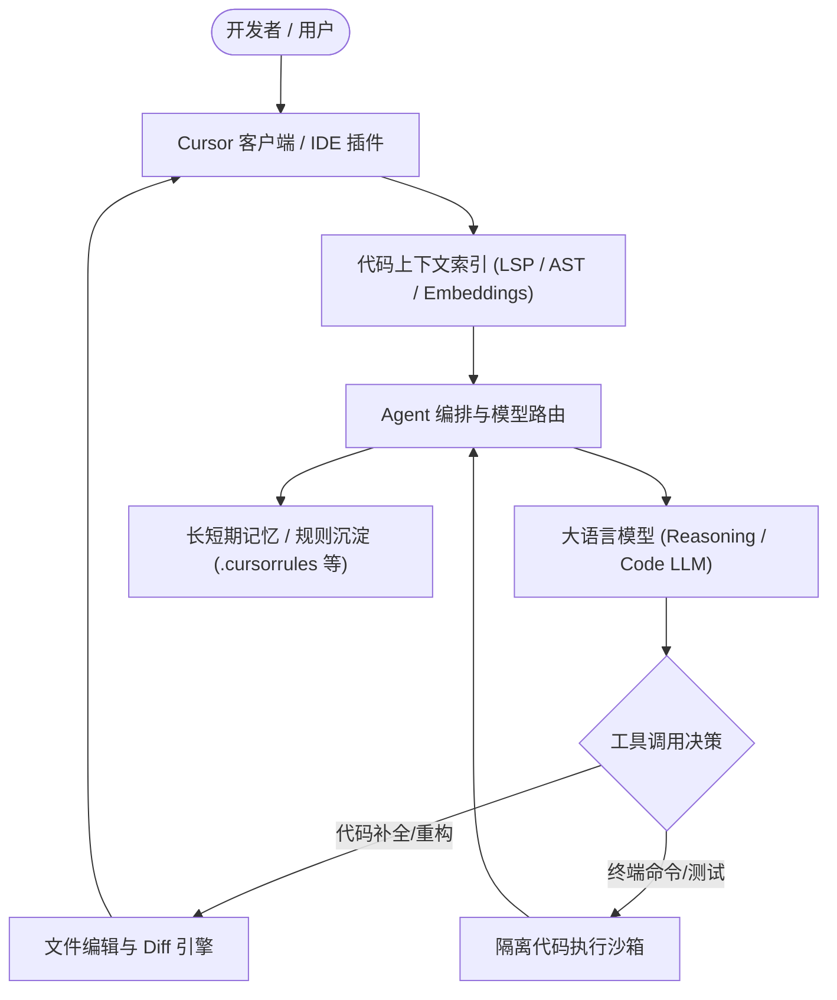

# Cursor — Harness 架构分析

## 概览

| 应用分类 | 分析时间 | 信息源数量 | 整体置信度 |
| :--- | :--- | :--- | :--- |
| engineering | 2026-11-24 10:29:57 | 5 | ★★★☆☆ |

## 架构总览

## 架构摘要

Cursor 是一套工业级 AI 编程助手 Harness，核心通过'快速补全 + 复合编辑'双 Agent 架构，配合 AST/LSP 混合代码检索、流式 Diff 补丁协议与细腻的人机审阅交互，打造了当前工程型 Agent 的体验标杆。

## 共性维度分析

### Agent 编排

**置信度**：★★★★★

多 Agent 协作流 (Tab 快速补全 Agent + Composer 全局编辑 Agent + Background Indexing Agent)

Cursor 内部区分低延迟的行内补全链路与高自主度的 Composer 链路。Composer 采用分层规划策略：Planner 负责将自然语言需求分解为多文件修改方案，Execution Agent 负责针对单个文件生成精确 Diff。

**关键设计决策**：
- 区分实时补全 (200ms) 与复合编辑 (异步流式)，使用完全隔离的 Agent 运行管线
- Composer 支持多文件并发计划与单步确认机制，防止大范围破坏性变更
- 支持动态提示注入与多轮上下文追踪，保留代码编辑轨迹

**可借鉴点**：
1. 针对不同延迟要求的场景建立多 Agent 分工，不要用单个通用 Agent 处理所有任务
2. 在工程型 Agent 中，规划与执行分层至关重要，单步执行容易陷入局部错误

### 模型路由

**置信度**：★★★★★

基于任务复杂度的分级模型路由 (Claude 3.5 Sonnet 主力 + 自研低延迟小模型补全)

针对行内 Tab 补全使用自研/微调的小型模型（几十毫秒内返回），保证打字不卡顿；针对代码重构、全库问答和 Composer，默认路由至 Claude 3.5 Sonnet 或 GPT-4o，平衡效果与成本。

**关键设计决策**：
- 行内自动补全完全避开昂贵商用大模型，使用专用 Speculative Decoding 推理架构
- 复杂多文件重构优先路由至长上下文且代码推理极佳的模型
- 提供用户自定义 API Key 与模型切换降级容灾

**可借鉴点**：
1. 模型路由是控制 Agent 成本与延迟的最核心杠杆，按任务复杂度严格分流
2. 工程代码场景对模型推理准确性极度敏感，不可盲目追求低成本而降低主力模型质量

### 工具链

**置信度**：★★★★★

围绕本地文件系统与语言服务器 (LSP) 的精细工具链

工具链包含：语义代码搜索 (Codebase Semantic Search)、文件定位、精准行区间读取 (Read Range)、文件批量编辑与 Diff 生成、终端命令执行。深度对接 VS Code LSP 语法诊断。

**关键设计决策**：
- 限制工具返回字符体积，避免工具输出撑爆模型上下文
- 提供文件读取的行区间限定工具，优先只读取函数定义而非全文
- 全面拥抱 MCP (Model Context Protocol) 开放外部工具扩展

**可借鉴点**：
1. 工具调用链设计必须遵循'最小上下文原则'，读取工具要支持精准切片
2. 深度利用语言服务器 (LSP) 获取语法树与错误诊断，能显著提升 Agent 自主修复能力

### 提示词工程

**置信度**：★★★★☆

分层规则注入与结构化 XML/Markdown 格式约束

通过项目级 `.cursorrules` 文件实现用户偏好自适应注入；在 System Prompt 中深度约束 Diff 输出格式，通过严格的 Search/Replace 标记减少生成标记量并保证精确匹配。

**关键设计决策**：
- 项目根目录规则文件分层加载 (.cursorrules -> workspace settings -> system prompt)
- 不要求模型输出完整修改后代码，仅输出精准的 SEARCH/REPLACE 块
- 限制模型废话，要求直接进入代码解决步骤

**可借鉴点**：
1. 工程型 Agent 的 Prompt 工程重在输出格式规范与代码 Diff 协议，而非长篇对话引导
2. 规则文件项目级本地化可以让 Agent 无缝对齐团队代码规范

### 上下文工程

**置信度**：★★★★★

本地 Merkle Tree 增量索引 + 混合检索 (BM25 + 向量嵌入 + LSP 引用)

在本地构建代码库的向量和关键词索引，后台通过文件监听 (File Watcher) 实现增量同步。在问答和编辑时，综合当前激活文件、光标位置、最近编辑历史以及搜索召回的相关代码片段拼接上下文。

**关键设计决策**：
- 全库代码索引在本地增量计算，哈希比对降低重新嵌入成本
- 混合检索结合语义匹配与精确符号匹配 (LSP Reference)
- 滑动上下文压缩，优先保留与当前问题最相关的核心类/方法

**可借鉴点**：
1. 代码上下文工程不能单靠向量检索，语法关系 (LSP) 的权重往往高于语义向量
2. 增量哈希计算是支撑大型代码仓库实时索引的技术基石

### 数据流与状态管理

**置信度**：★★★★☆

双向增量流式状态同步与本地会话 Checkpoint

用户输入与文件变更通过 WebSocket/IPC 管道流式传输；前端编辑器与后台 Agent 保持轻量状态机，记录编辑序列、待接受 Diff 队列以及撤销快照。

**关键设计决策**：
- 编辑器本地维护变更快照树，支持随时恢复到任意 Agent 执行前状态
- 流式推送字符级 Diff，降低首字等待焦虑

**可借鉴点**：
1. 状态管理必须考虑 Agent 失败或被用户打断时的恢复路径，建立完善的 Checkpoint 机制

### 安全沙箱

**置信度**：★★★★★

终端操作权限审批与文件修改权限白名单

Cursor 运行在开发者本地，因此采取'人机确认沙箱'机制：涉及终端运行命令时，默认要求用户审查确认（或提供严格的白名单）；文件修改前显示 Inline Diff 供开发者手动 Accept/Reject。

**关键设计决策**：
- 本地进程安全采取主动人工授权防线，不直接盲执行不可逆 shell 命令
- 代码隐私模式 (Privacy Mode)：保证代码不用于模型再训练

**可借鉴点**：
1. 桌面端工程 Agent 的安全关键在于'人机交接点'的设计，而非强隔离虚拟容器
2. 明确的隐私与数据边界是企业客户采纳的前提

### 人机协同

**置信度**：★★★★★

行内实时 Diff 审阅 + 自然语言直接交互编辑 (Inline Edit)

Cursor 将人类与 AI 的协作拉到极致细腻的颗粒度：不是整包提交代码，而是在代码编辑器内原生展示绿色新增与红色删除，开发者可以按单行或单文件快捷键接受/拒绝。

**关键设计决策**：
- 原生编辑器 UI 深度侵入，将 AI 交互融入原有快捷键习惯 (Cmd+K / Cmd+I)
- 提供一键快捷反馈（Reject 时提示说明原因直接重新生成）

**可借鉴点**：
1. 最顶级的 Agent 人机协作不是让 AI 替人做完一切，而是让人以最低认知成本审查和控制 AI

### 扩展生态

**置信度**：★★★★★

完整兼容 VS Code 扩展生态 + MCP 协议与自定义规则生态

Fork 自 VS Code，100% 继承其庞大插件市场；同时支持 MCP 接入外部数据源和工具，形成开放强大的生态飞轮。

**关键设计决策**：
- 选择 Fork 成熟 IDE (VS Code) 而非从零造轮子，极大降低用户迁移阻力
- 拥抱标准 MCP 协议，将生态扩展压力转嫁给社区

**可借鉴点**：
1. 不要从零构建新环境，寄生于现有成熟工作流（如 IDE / 浏览器）能加速 Agent 生态繁荣

## 品类专属分析

### 沙箱隔离模型

**置信度**：★★★★☆

宿主安全确认模式 + 本地执行边界

不使用昂贵的云端 VM 隔离，而是依靠桌面客户端权限边界与用户显式授权确认实现安全防护。

**关键设计决策**：
- 本地权限委托
- 破坏性命令前置拦截

**可借鉴点**：
1. 轻量客户端工程 Agent 优先选择授权边界而非容器虚拟化

### 代码库理解引擎

**置信度**：★★★★★

LSP 静态分析 + Tree-sitter AST + 增量向量混合索引

利用 Tree-sitter 进行代码块分块解析，结合语义嵌入和 LSP 的定义跳转引用关系，构建高保真代码拓扑网。

**关键设计决策**：
- AST 级 Chunking 替代暴力切文本
- LSP 符号索引注入

**可借鉴点**：
1. 代码切块必须遵循语法节点（类、方法定义），否则检索出的代码片段断章取义

### Diff 生成与管理

**置信度**：★★★★★

高效流式 SEARCH/REPLACE 块解析与实时语法合规性检查

模型仅输出更改前后片段，客户端在内存中快速做 Levenshtein 模糊匹配定位，并在应用变更前验证语法完整性。

**关键设计决策**：
- 模糊匹配容错解决行号漂移问题
- 流式生成流式渲染

**可借鉴点**：
1. 避免让大模型返回完整大文件代码，Diff 补丁协议是降低延迟的命脉

### 终端与进程管理

**置信度**：★★★★★

集成 VS Code PTY 终端会话与命令输出环形缓冲区

Agent 可以监听终端退出码与错误输出 (stderr)，自动识别依赖缺失或测试失败并触发修复循环。

**关键设计决策**：
- 捕获最后 N 行错误日志注入 Prompt
- 支持多终端环境隔离

**可借鉴点**：
1. 终端执行不仅仅是发命令，更关键是对退出码和错误日志的自动化感知闭环

### 检查点与回滚

**置信度**：★★★★★

Git 兼容的轻量暂存区快照与多步撤销树

在执行复杂 Composer 多文件修改前记录编辑快照，用户一键按 Esc 或 Reject 即可无缝恢复所有文件。

**关键设计决策**：
- 原子性多文件应用与一键还原
- 会话内历史版本记录

**可借鉴点**：
1. 没有撤销能力的工程 Agent 会让用户产生强烈的恐惧心理，回滚是建立信任的核心

## 关键洞察

1. 双 Agent 架构分离极低延迟补全与高复杂度多文件编辑，兼顾速度与智能
2. 代码切块遵循 Tree-sitter AST 语法树，结合 LSP 符号检索，远优于纯文本 RAG
3. Diff 补丁协议 (Search/Replace) 极大压缩了 Token 输出量并降低网络开销
4. 行内单步审查与撤销快照给开发者极致的安全感与确定性
5. 利用现有 VS Code 庞大生态与 MCP 协议快速撬动开发者社区

## 分析说明

> **免责与分析声明**：
> 本分析报告基于技术博客、公开技术分享、官方开源仓库（README 与代码目录组织）等公开信息源，结合大语言模型分析推断得出。分析结果仅代表对公开架构设计模式的解读与推断，供技术研究与架构设计参考，不代表对应产品官方的内部完整实现或商业机密。
