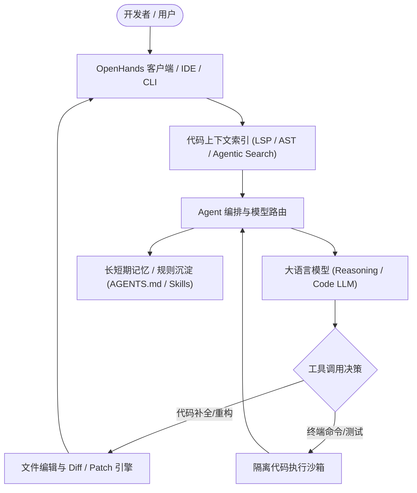
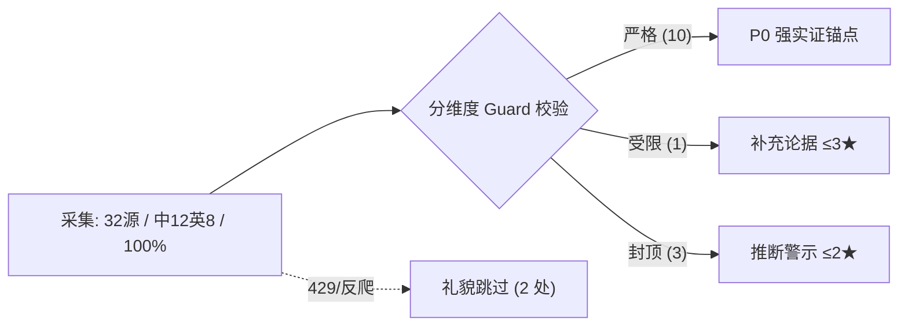
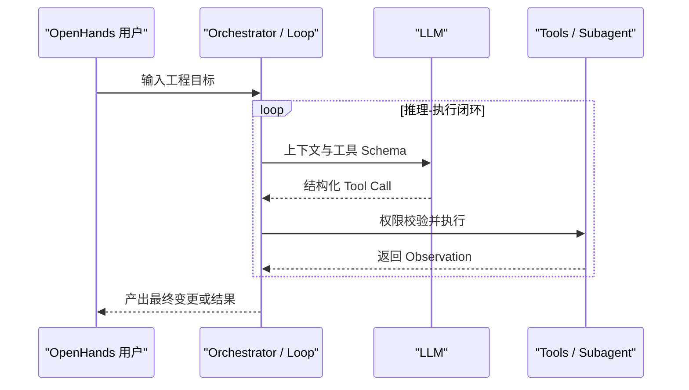
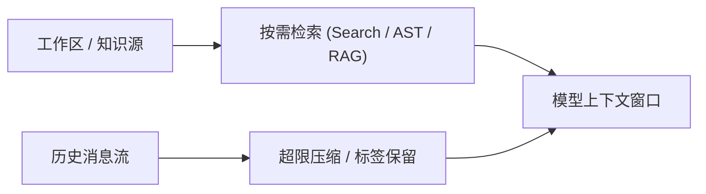
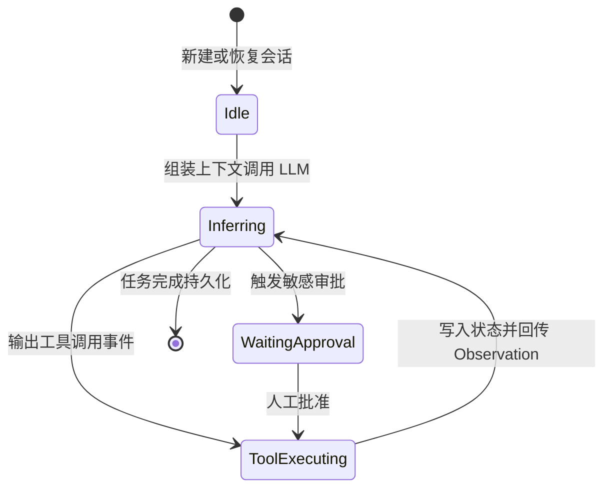
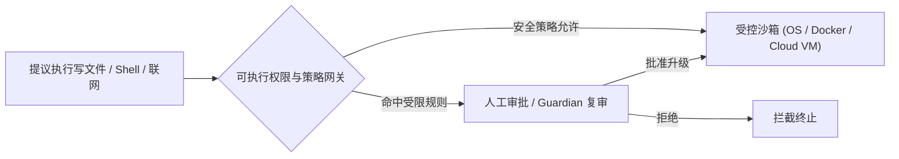
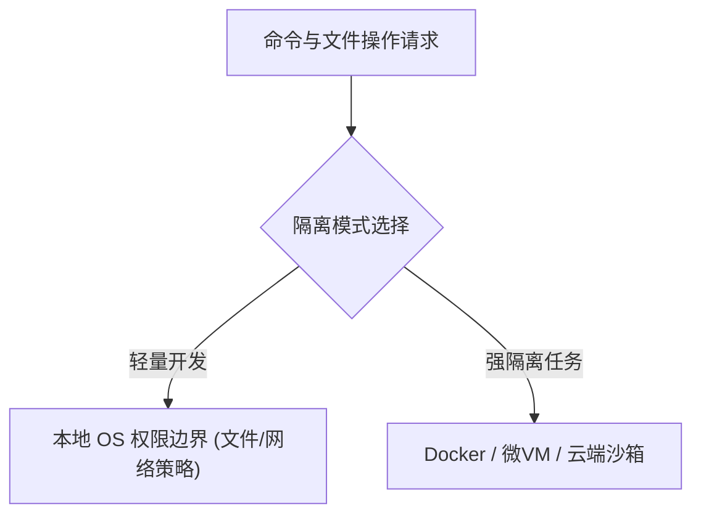

# OpenHands — Harness 架构深度分析报告

## 概览指标

| 所属品类 | 分析时间 | 信源覆盖数 | 严格实证维度比 | 原文实证摘录数 | 架构置信度 |
| :--- | :--- | :---: | :---: | :---: | :---: |
| engineering | 2026-11-26 13:43:10 | 32 | 10/14 | 19 | ★★★★☆ |

## 架构总览拓扑 (System Topology)



## 核心架构摘要

OpenHands 已演进为由 Agent Canvas（浏览器/桌面控制面客户端）、Agent Server（核心执行后端）与 Software Agent SDK（无状态事件驱动内核）组成的三层工程型 Harness 平台：支持接入 Docker/VM/Cloud 沙箱，通过 LiteLLM/ACP 路由本地与外部编程 Agent，并通过 MCP（SSE/SHTTP/stdio）和 `.agents/skills` 实现工具与技能扩展。

## 🎯 应用层：产品经理产品方案指导 (PM Solution Guidance)

> **定位说明**：本节专为公司**产品经理 (PM)** 与**业务负责人**编写，将底层复杂的 Harness 架构拆解转化为具体的产品形态定义、交互信任机制及第一期 PRD 落地清单。

**📊 方案支撑数据例证**：实证技术锚点 `10` 项 ｜ 社区评论来源 `3` 处 ｜ 待避坑未实证警示 `3` 项 ｜ 建议 MVP P0 `4` 项 / P1 `3` 项

### 1. 适配产品形态定位
- **可独立部署的工程型 AI Agent 控制工作台（Web 控制面 + Docker/云端隔离沙箱执行器）**
- **面向团队的异步研发助手（通过 Webhook 接收 GitHub/GitLab/Slack/Jira 任务并自动提 PR）**
- **企业内部兼容多种编程 Agent（如通过 ACP/MCP 纳管各研发工具）的统一管控门户**

### 2. 产品自主度评级与人机信任机制
- **建议自主度评级**：`L3（沙箱隔离下的半自动端到端执行；本地直连模式建议降级为 L2 逐关键操作人工确认）`
- **用户审查与信任设计**：
  1. 采用控制面 UI + 结构化 Tool Visualizer 卡片清晰呈现 Bash 执行、文件修改、搜索和子任务进度，切勿只吐原始 Markdown 日志；
2. 界面显式标明当前沙箱隔离等级（⚠️ 本地裸跑 vs 🔒 Docker 挂载 vs ☁️ 云沙箱），本地无沙箱模式必须前置高危命令确认断点；
3. 针对多 Agent 并发协作，在 Workspace 维度显式展示锁/Worktree 分支归属，缓解上下文冲突焦虑。

### 3. 响应体验与成本控制权衡 (Trade-offs)
• 引入只读 Planning 阶段与默认 Execution 阶段的模型/工具分层，先只读收敛方案再进入多轮终端测试修复，避免高成本大模型盲目试错；
• 上下文窗口必须配备类似 Condenser 的动态事件压缩机制，并在自动化任务上设置步数/预算上限；
• 非交互批量研发任务采用异步沙箱 Pod 执行，交互修改复用热备容器（Warm Pod）消除容器冷启动等待。

### 4. 公司自建同类产品 MVP 功能清单 (PRD 参考)

**P0 必须项 (不做产品无法上线)**：
- [x] 可一键挂载指定工程目录的 Docker 隔离沙箱与端口自检启动器
- [x] 事件流化的工具执行卡片 UI（Bash + 文件编辑 + xterm 终端）
- [x] MCP 标准客户端接入（stdio/SSE），复用外部工具生态
- [x] 上下文超限自动压缩机制与高危操作人工审批开关

**P1 增强项 (第二期迭代推荐)**：
- [ ] 只读规划 Agent 与执行 Agent 的两阶段切换模板
- [ ] 支持接入外部 CLI Agent（ACP 协议兼容）
- [ ] 企业统一代理（LiteLLM Proxy + SSO + 事件 Webhook 触发）

🚨 **产品经理避坑红线 (Do NOT do in V1)**：
- ❌ 切忌在未明确警示或隔离边界的情况下让浏览器/桌面客户端直接无约束执行本地 Shell 与文件系统写入；
- ❌ 切忌将多工具结果全部无结构化塞进聊天流，导致用户失去对变更和终端状态的感知；
- ❌ 切忌在本地 CLI/Canvas 启动器中硬编码端口且不做冲突自动探测；
- ❌ 切忌在缺乏 Worktree/分支隔离设计时开放多 Agent 并发修改同一工作目录。

## 📦 中间产物与权威用户真实评论 (Intermediate Artifact & User Reviews)

> **转化依据说明**：本节汇总经分维度 Guard 校验后的技术事实、双语检索覆盖度与权威社区真实用户反馈，是上方『产品经理方案指导』的直接转化底座。

### 实证验证漏斗参考图 (Mermaid)



- **📊 分维度 Guard 量化统计**：✅ 严格实证 `10` 项 (`71%`) ｜ ⚠️ 部分实证 `1` 项 ｜ 🚧 推断封顶 `3` 项
- **核心实证锚点数**：`9` 项（已作为 P0 产品方案主依据）
- **未实证警示数**：`3` 项（已拦截防照搬）

### 双语多维度检索覆盖度评估

- **综合覆盖度**：`100%` ｜ **提问语言命中**：`12` 条 ｜ **英语命中**：`8` 条
- **🛡️ 反爬/限流礼貌退出记录**：共 `2` 处（已自动熔断保护，未强行绕过）：
  - `https://aiwiki.ai/wiki/openhands` (`rate_limited_429`)
  - `https://aiwiki.ai/wiki/openhands` (`rate_limited_429`)

| 语言 | 检索角度 | 检索词 | 命中数 | 深抓正文 | 采集字符 |
| :--- | :--- | :--- | :---: | :---: | :---: |
| en | architecture_qa | `how the OpenHands works AI architecture` | 4 | 1 | 4500 |
| en | architecture_qa | `OpenHands AI engineering blog system architecture` | 0 | 0 | 0 |
| en | implementation_tech | `OpenHands system prompt tools agent harness` | 4 | 0 | 0 |
| en | source_reverse | `OpenHands AI agent github reverse engineering` | 0 | 0 | 0 |
| zh | architecture_qa | `OpenHands的架构是什么` | 0 | 0 | 0 |
| zh | architecture_qa | `OpenHands AI 底层原理 技术架构 拆解` | 0 | 0 | 0 |
| zh | implementation_tech | `OpenHands 提示词 工具调用 Agent 工作流` | 4 | 2 | 6778 |
| zh | source_reverse | `OpenHands 开源 源码 逆向` | 4 | 0 | 0 |
| en | user_reviews | `"OpenHands" (site:g2.com OR site:producthunt.com OR site:trustpilot.com) review` | 0 | 0 | 0 |
| en | user_reviews | `"OpenHands" ("pros and cons" OR "frustrating" OR "review" OR "issues") site:reddit.com` | 0 | 0 | 0 |
| zh | user_reviews | `"OpenHands" (真实体验 OR 缺点 OR 吐槽 OR 评测) (site:zhihu.com OR site:v2ex.com OR site:juejin.cn)` | 4 | 0 | 585 |

### 权威社区真实用户评论拆解

**👍 真实用户高频好评 (核心爽点)**：
- 能脱离单纯代码补全，端到端独立完成写代码、跑终端命令、查错与自愈修复的完整工程闭环
- 开源且支持多后端（本地 / Docker 沙箱 / 自托管 VM / 云端），团队可直接按开源标准落地并作为 staging 试点验证

**👎 真实用户高频吐槽 (痛点与短板)**：
- 部分早期版本本地安装/启动（npm @openhands/agent-canvas）默认硬编码端口（如 3001）等环境兼容问题引发大量排查评论（204 评论高热度 Issue）
- 多 Agent 并发写同一仓库时容易出现「上下文冲突与代码变更责任归属不清」的团队协作成本

**⚡ 人机协作与信任摩擦点**：
- 本地无容器隔离模式下权限过高，而切换到 Docker 全栈环境配置与资源开销又相对较重，开发者易在安全边界与启动便利间犹豫

**💬 代表性一线用户原话**：
> "[closed, 204 评论] [Bug]: detect ports automatically instead of always using 3001: Installation Method npm (`npx @openhands/agent-canvas`)"
> "对工程管理者，落地路径很具体：先在非关键服务上试点多 agent Workspace，配 OpenHands 沙箱做 staging……但也提示一个新的组织问题——多 agent 并发写同一仓库时的"上下文冲突与责任归属"会成为新的协作成本。"

**评论采集来源**：https://github.com/All-Hands-AI/OpenHands/issues / https://juejin.cn/post/7683024148631420937 / https://zhuanlan.zhihu.com/p/2030684535390745084

## 🔬 中间层：Harness 架构维度深度拆解 (Dimension Analysis)

> **分析手法说明**：本节运用 9 大共性工程维度与 5 大品类专属穿透维度，对底层调度、上下文、沙箱与工具链进行技术解剖，每个维度均附带独立 **Mermaid 机制参考图** 与 **量化数据例证**。

### 1. 基础共性维度拆解

**共性维度多维分布图 (Mermaid：快速识别高权重低实证短板)**：
```mermaid
xychart-beta
    title "OpenHands 共性维度评分(柱)与权重(线)对比"
    x-axis [编排, 路由, 工具, 提示, 上下文, 状态, 沙箱, 协同, 生态]
    y-axis "评分(满分5)" 0 --> 6
    bar [5, 5, 5, 4, 3, 4, 5, 5, 5]
    line [5, 5, 5, 4, 5, 4, 5, 5, 5]
```

| 维度 | 品类权重 | 置信度 | Guard 状态 | 原文引用数 | 依据来源数 |
| :--- | :---: | :---: | :---: | :---: | :---: |
| Agent 编排 | 5/5 | ★★★★★ | `strict_verified` | 2 | 2 |
| 模型路由 | 5/5 | ★★★★★ | `strict_verified` | 2 | 2 |
| 工具链 | 5/5 | ★★★★★ | `strict_verified` | 2 | 2 |
| 提示词工程 | 4/5 | ★★★★☆ | `strict_verified` | 1 | 2 |
| 上下文工程 | 5/5 | ★★★☆☆ | `partial_verified` | 1 | 1 |
| 数据流与状态管理 | 4/5 | ★★★★☆ | `strict_verified` | 2 | 2 |
| 安全沙箱 | 5/5 | ★★★★★ | `strict_verified` | 2 | 2 |
| 人机协同 | 5/5 | ★★★★★ | `strict_verified` | 2 | 1 |
| 扩展生态 | 5/5 | ★★★★★ | `strict_verified` | 2 | 2 |

### Agent 编排

**置信度**：★★★★★ | **品类权重**：`5/5` | **联系程度**：🔴 核心强关联 | **Guard 状态**：✅ 严格实证通过

控制面与执行后端分离的多后端编排（Agent Canvas + Agent Server + Software Agent SDK），支持原生 Agent 与 ACP 外部 Agent 协作

Agent Canvas 作为控制平面管理会话、终端、文件与自动化任务，后端由基于 Software Agent SDK 的 Agent Server 执行无状态推理-行动循环（ActionEvent/ObservationEvent），并支持本地、Docker、VM、Modal 及 OpenHands Cloud 等多种运行时，同时可编排规划-执行两阶段工作流或接入 Claude Code / Codex 等 ACP 兼容智能体。

**机制参考图 (Mermaid)**：


**📊 数据例证 (Data Evidence)**：命中原文片段 `2` 条 ｜ 关联信源 `2` 篇 ｜ 提炼工程决策 `2` 项
**原文佐证片段 (Verified Quotes)**：
> "OpenHands is an open platform for running AI coding agents across real engineering work. Run agents in conversations, automate them with schedules and events, extend them with skills, plugins, and MCP servers, and build your own agents with the Software Agent SDK."
> "Agent Canvas is the browser client. It connects to backend services that own execution and persistent state:"
- **实证来源**：https://docs.all-hands.dev ； https://docs.all-hands.dev/openhands/usage/agent-canvas/overview

**关键设计决策 (Engineering Decisions)**：
- 控制面（Browser/Desktop UI）与执行面（Agent Server / Sandbox Backend）解耦
- 统一基于 Software Agent SDK 驱动交互式开发、云端沙箱与定时/事件自动化任务

**架构借鉴点 (Takeaways)**：
1. 将前端交互与后端沙箱运行时解耦，有助于同一套 Agent 内核平滑切换本地开发、自托管服务器与云端托管模式

### 模型路由

**置信度**：★★★★★ | **品类权重**：`5/5` | **联系程度**：🔴 核心强关联 | **Guard 状态**：✅ 严格实证通过

多模型与跨 Agent 异构路由，支持本地模型、商业模型 API（企业版结合 LiteLLM proxy）及 ACP 外部智能体接入

用户可通过 Provider API 或本地模型运行推理，前端也内置了 LLM 订阅 Schema 扩展与模型设置项，同时还能通过 ACP 协议将推理直接路由给 Claude Code、Codex 或 Gemini CLI 等外部 Agent 执行。

**📊 数据例证 (Data Evidence)**：命中原文片段 `2` 条 ｜ 关联信源 `2` 篇 ｜ 提炼工程决策 `1` 项
**原文佐证片段 (Verified Quotes)**：
> "The LLM models can run locally, through a provider API or be accessed through an ACP agent."
> "Use any LLM, or connect an existing coding agent such as Claude Code or Codex."
- **实证来源**：https://docs.all-hands.dev/openhands/usage/agent-canvas/overview ； https://docs.all-hands.dev

**关键设计决策 (Engineering Decisions)**：
- 模型配置与订阅 Schema 抽象在设置层，支持本地/API/外部 ACP Agent 自由切换

**架构借鉴点 (Takeaways)**：
1. 对开源开发者平台而言，BYOK 多模型适配与复用现有 CLI Agent（ACP）能显著降低迁移门槛

### 工具链

**置信度**：★★★★★ | **品类权重**：`5/5` | **联系程度**：🔴 核心强关联 | **Guard 状态**：✅ 严格实证通过

内置 Bash/文件编辑器/搜索/任务工具集并配合前端 React 专属工具可视化卡片，同时原生支持 MCP 工具协议

前端为 bash、file-editor、search、task 注册了专门的 Action/Observation 渲染器，未注册的工具则平滑降级到通用 Markdown 渲染管线；外部工具统一经由 MCP 客户端连接器加载注册。

**📊 数据例证 (Data Evidence)**：命中原文片段 `2` 条 ｜ 关联信源 `2` 篇 ｜ 提炼工程决策 `2` 项
**原文佐证片段 (Verified Quotes)**：
> "Model Context Protocol (MCP) is an open standard that allows OpenHands to communicate with external tool servers, extending the agent’s capabilities with custom tools, specialized data processing, external API access, and more."
> "Tool visualizers render a tool call's action / observation card body as React components instead of markdown. Unregistered tools keep using the markdown pipeline (see `dispatcher.ts`), so this list can grow one tool at a time."
- **实证来源**：https://docs.all-hands.dev/overview/model-context-protocol ； https://raw.githubusercontent.com/All-Hands-AI/OpenHands/main/src/components/features/chat/tool-visualizers/index.ts

**关键设计决策 (Engineering Decisions)**：
- 核心工程工具独立设计结构化 Action/Observation 卡片，其余工具自动回退通用 Markdown 渲染
- 启动阶段集中解析 MCP 配置并向 Agent 注册外部工具服务

**架构借鉴点 (Takeaways)**：
1. 为高频 Bash 与文件编辑提供定制可视化卡片、同时为泛工具提供通用回退，能在开发成本与体验间取得最佳平衡

### 提示词工程

**置信度**：★★★★☆ | **品类权重**：`4/5` | **联系程度**：🟡 中度关联 | **Guard 状态**：✅ 严格实证通过

基于仓库内 `.agents/skills` 与自定义 Agent 角色隔离（只读 Planning Prompt vs 全功能 Execution Prompt）管理提示策略

OpenHands 仓库自身通过 `.agents/skills/*` 为不同研发任务挂载专业指导规则与参考文档，并在 SDK 指南中示范通过定制只读规划 Agent 与全编辑执行 Agent 的 System Prompt 分工优化复杂任务表现。

**📊 数据例证 (Data Evidence)**：命中原文片段 `1` 条 ｜ 关联信源 `2` 篇 ｜ 提炼工程决策 `2` 项
**原文佐证片段 (Verified Quotes)**：
> "This example demonstrates a two-stage workflow: 1. Planning Agent: Analyzes the task and creates a detailed implementation plan 2. Execution Agent: Implements the plan with full editing capabilities"
- **实证来源**：https://docs.openhands.org.cn/sdk/guides/agent-custom ； https://github.com/All-Hands-AI/OpenHands/tree/main

**关键设计决策 (Engineering Decisions)**：
- 使用模块化 Skill 文件机制向 AgentContext 按需注入提示与约束
- 将只读规划与全权编辑分为两个独立 Prompt/工具预设（planning vs default）

**架构借鉴点 (Takeaways)**：
1. 把冗长工作流规范拆成可插拔 Skill 并隔离规划/执行权限，比堆砌单一超长 System Prompt 更易维护

### 上下文工程

**置信度**：★★★☆☆ | **品类权重**：`5/5` | **联系程度**：🔴 核心强关联 | **Guard 状态**：⚠️ 部分实证受限

> ℹ️ *核心维度仅有单条二手/评论引证，尚缺源码或官方文档实锤（置信度封顶 3 星）。*

通过 AgentContext 容器加载 Skills/元数据，并在单步推理前调用 Condenser（压缩器）对超限事件流历史进行压缩

在开源 SDK 文档中描述了无状态推理循环在调用 LLM 前先执行 condenser.condense()，若窗口超限则触发 CondensationRequest 事件做历史缩减；此外借助 Skill 机制避免无差别全量注入上下文。

**机制参考图 (Mermaid)**：


**📊 数据例证 (Data Evidence)**：命中原文片段 `1` 条 ｜ 关联信源 `1` 篇 ｜ 提炼工程决策 `1` 项
**原文佐证片段 (Verified Quotes)**：
> "使用当前事件视图调用 condenser.condense() 如果返回 View ：使用压缩后的事件进行 LLM 查询（在同一步骤中继续）"
- **实证来源**：https://docs.openhands.org.cn/sdk/arch/agent

**关键设计决策 (Engineering Decisions)**：
- 引入独立 Condenser 组件在 token 接近上限时压缩事件历史 View

**架构借鉴点 (Takeaways)**：
1. 将上下文压缩封装成事件流上的独立钩子（Condenser），可在不改动核心执行循环的情况下迭代压缩算法

### 数据流与状态管理

**置信度**：★★★★☆ | **品类权重**：`4/5` | **联系程度**：🟡 中度关联 | **Guard 状态**：✅ 严格实证通过

前端 Agent Canvas 与无状态/持久化执行后端通过类型化 ActionEvent 与 ObservationEvent 事件流交互

浏览器 UI 通过 API 连接维护会话与持久状态的 Agent Server / Backend，工具调用与观测结果封装为严格类型化的 Action/Observation 事件并在前端渲染分发。

**机制参考图 (Mermaid)**：


**📊 数据例证 (Data Evidence)**：命中原文片段 `2` 条 ｜ 关联信源 `2` 篇 ｜ 提炼工程决策 `1` 项
**原文佐证片段 (Verified Quotes)**：
> "Agent Canvas is the browser client. It connects to backend services that own execution and persistent state:"
> "actionVisualizers = indexByKind((v) => v.actionKinds);"
- **实证来源**：https://docs.all-hands.dev/openhands/usage/agent-canvas/overview ； https://raw.githubusercontent.com/All-Hands-AI/OpenHands/main/src/components/features/chat/tool-visualizers/index.ts

**关键设计决策 (Engineering Decisions)**：
- 持久化会话与执行状态全部由 Backend 服务持有，客户端保持轻量控制面

**架构借鉴点 (Takeaways)**：
1. 类型化的 Action/Observation 事件契约是前后端协同渲染及断点恢复的清晰边界

### 安全沙箱

**置信度**：★★★★★ | **品类权重**：`5/5` | **联系程度**：🔴 核心强关联 | **Guard 状态**：✅ 严格实证通过

明确标注本地 Agent Canvas 本身不提供强隔离，生产或高风险场景需切换 Docker 容器、VM 或云端托管沙箱，并在企业版配合 Keycloak 与 Runtime API

官方安装文档直接警示将 Agent 与 ACP 进程视为不可信工作负载（默认拥有当前用户文件读写与 Shell 权限），推荐通过挂载项目目录的 Docker 容器、自建 VM 或 OpenHands Cloud 沙箱收窄权限边界；SDK 层配合 SecurityAnalyzer 评估风险并可置为 WAITING_FOR_CONFIRMATION 等待审批。

**机制参考图 (Mermaid)**：


**📊 数据例证 (Data Evidence)**：命中原文片段 `2` 条 ｜ 关联信源 `2` 篇 ｜ 提炼工程决策 `2` 项
**原文佐证片段 (Verified Quotes)**：
> "Treat agents and ACP processes as untrusted: they can run shell commands and read or write files with your user account’s permissions. Agent Canvas is the client and does not isolate them — use a container, sandbox, or VM for a tighter boundary"
> "Use a sandboxed local environment with mounted project directories."
- **实证来源**：https://docs.all-hands.dev/openhands/usage/agent-canvas/setup ； https://docs.all-hands.dev/openhands/usage/agent-canvas/overview

**关键设计决策 (Engineering Decisions)**：
- 显式区分开发便利的本地模式与容器/VM 隔离沙箱边界
- 利用挂载特定工程目录的方式限制 Docker 容器内 Agent 可见文件系统

**架构借鉴点 (Takeaways)**：
1. 对桌面/浏览器控制的开源编程 Agent，必须在快速本地模式之外内建一级 Docker/VM 隔离切换并明示安全边界

### 人机协同

**置信度**：★★★★★ | **品类权重**：`5/5` | **联系程度**：🔴 核心强关联 | **Guard 状态**：✅ 严格实证通过

集中式 Web/Desktop 控制面统一查看对话、文件编辑、终端与自动化任务，并对高风险操作提供确认状态中断与人工审批

用户可在单一控制界面内审阅文件变更、观察内置 Bash/FileEditor/Search/Task 视觉卡片与 xterm 终端反馈，还支持接入外部 MCP 与自动化调度并在敏感 Action 上等待确认。

**📊 数据例证 (Data Evidence)**：命中原文片段 `2` 条 ｜ 关联信源 `1` 篇 ｜ 提炼工程决策 `2` 项
**原文佐证片段 (Verified Quotes)**：
> "From one place, you can manage conversations, files, terminals, model configuration, backends, and automations."
> "This is where you chat, inspect files, manage settings, and configure automations."
- **实证来源**：https://docs.all-hands.dev/openhands/usage/agent-canvas/overview

**关键设计决策 (Engineering Decisions)**：
- 将对话、文件编辑、终端和自动化收拢在一个可观察控制面中
- 使用专属可视化组件展示工具行为，降低用户理解 Agent 操作的认知负担

**架构借鉴点 (Takeaways)**：
1. 高自主度编码 Agent 仍需清晰的实时文件/终端可观测面板，才能让开发者在出错时及时介入

### 扩展生态

**置信度**：★★★★★ | **品类权重**：`5/5` | **联系程度**：🔴 核心强关联 | **Guard 状态**：✅ 严格实证通过

四维开放扩展体系：MCP 协议（SSE/SHTTP/stdio）、`.agents/skills` 技能包、插件机制、以及开放的 ACP（外部编码智能体）协议

除了兼容标准 MCP Server（支持 SSE、SHTTP、stdio 三种传输），OpenHands 还将扩展性延展到整个编码 Agent 生态——支持连接 Claude Code、Codex、Gemini CLI 等任何 ACP 兼容 Agent，并开放 `@openhands/extensions` 与 Software Agent SDK。

**📊 数据例证 (Data Evidence)**：命中原文片段 `2` 条 ｜ 关联信源 `2` 篇 ｜ 提炼工程决策 `2` 项
**原文佐证片段 (Verified Quotes)**：
> "Connects to configured servers (SSE, SHTTP, or stdio)"
> "Run OpenHands, Claude Code, Codex, Gemini, Pi, OpenCode, or any ACP-compatible agent across local, remote, and cloud backends."
- **实证来源**：https://docs.all-hands.dev/overview/model-context-protocol ； https://raw.githubusercontent.com/All-Hands-AI/OpenHands/main/README.md

**关键设计决策 (Engineering Decisions)**：
- 同时支持 MCP 三种传输协议（SSE / SHTTP / stdio）
- 通过 ACP 标准反向兼容外部主流编码 Agent

**架构借鉴点 (Takeaways)**：
1. 控制面开源平台通过同时拥抱 MCP（工具标准）和 ACP（智能体标准）能够避免生态孤岛

### 2. 品类专属穿透维度拆解

| 专属维度 | 置信度 | Guard 状态 | 原文引用数 | 依据来源数 |
| :--- | :---: | :---: | :---: | :---: |
| 沙箱隔离模型 | ★★★★★ | `strict_verified` | 2 | 2 |
| 代码理解引擎 | ★☆☆☆☆ | `unverified_capped` | 0 | 0 |
| Diff 与变更管理 | ★☆☆☆☆ | `unverified_capped` | 0 | 0 |
| 终端与进程管理 | ★★★★★ | `strict_verified` | 1 | 2 |
| 检查点与回滚 | ★☆☆☆☆ | `unverified_capped` | 0 | 0 |

### 沙箱隔离模型

**置信度**：★★★★★ | **联系程度**：🔴 核心强关联 | **Guard 状态**：✅ 严格实证通过

可切换多层执行隔离模型（本地直接运行 / 挂载目录的 Docker 容器 / VM / Modal / OpenHands Cloud 托管沙箱）

客户端默认直连本地后端以获得零配置启动体验，但明确声明非隔离状态；正式任务可通过 Docker 显式挂载项目目录，或在远程 VM / Modal / OpenHands Cloud 运行完全隔离的沙箱容器。

**机制参考图 (Mermaid)**：


**📊 数据例证 (Data Evidence)**：命中原文片段 `2` 条 ｜ 关联信源 `2` 篇 ｜ 提炼工程决策 `1` 项
**原文佐证片段 (Verified Quotes)**：
> "Treat agents and ACP processes as untrusted: they can run shell commands and read or write files with your user account’s permissions. Agent Canvas is the client and does not isolate them — use a container, sandbox, or VM for a tighter boundary"
> "The browser interface connects to one or more backends that run the agent and its tools. By default, that backend runs on your machine, but you can instead use Docker, a VM, Modal, or OpenHands Cloud."
- **实证来源**：https://docs.all-hands.dev/openhands/usage/agent-canvas/setup ； https://docs.all-hands.dev/openhands/usage/agent-canvas/overview

**关键设计决策 (Engineering Decisions)**：
- 默认无隔离快速体验 vs 一键切换 Docker/云端独立 Runtime 沙箱

**架构借鉴点 (Takeaways)**：
1. 提供渐进式隔离阶梯（本地 → Docker 挂载 → 托管沙箱）平衡了开箱即用与生产安全

### 代码理解引擎

**置信度**：★☆☆☆☆ | **联系程度**：🔴 核心强关联 | **Guard 状态**：🚧 无实证推断封顶

> ⚠️ *🔴 核心强关联维度缺乏原文实证（或引用未命中原文），置信度已严格封顶 1 星，PM 切勿直接作为 P0 硬依据。*

基于终端搜索工具与只读规划/探索子集进行代码库定位，本次采集一手语料未见独立 AST/LSP 索引架构细节

在已采集的主站与前端源码中可确认包含 Search 与 File Editor 工具可视化器，但未抓取出底层代码索引（如 Tree-sitter/向量/LSP）的具体实现代码，此处按事实严谨标注为待补充验证。

**📊 数据例证 (Data Evidence)**：命中原文片段 `0` 条 ｜ 关联信源 `0` 篇 ｜ 提炼工程决策 `1` 项

**关键设计决策 (Engineering Decisions)**：
- 通过搜索与文件读写工具探索工作区目录与源码

**架构借鉴点 (Takeaways)**：
1. 若团队需要大规模仓库定位精度，需进一步审阅 `openhands-sdk` Python 仓库确认具体代码检索实现

### Diff 与变更管理

**置信度**：★☆☆☆☆ | **联系程度**：🔴 核心强关联 | **Guard 状态**：🚧 无实证推断封顶

> ⚠️ *🔴 核心强关联维度缺乏原文实证（或引用未命中原文），置信度已严格封顶 1 星，PM 切勿直接作为 P0 硬依据。*

前端集成 Monaco Editor 与文件编辑器工具卡片，但本次抓取语料未包含底层 Diff 补丁生成与冲突消解细则

从依赖与组件目录可见其集成 `@monaco-editor/react` 与 `fileEditorVisualizer`，具体编辑格式（如 Search/Replace 或 Unified Diff 协议）本次未在一手源码中抓全。

**📊 数据例证 (Data Evidence)**：命中原文片段 `0` 条 ｜ 关联信源 `0` 篇 ｜ 提炼工程决策 `1` 项

**关键设计决策 (Engineering Decisions)**：
- 控制面集成可视化文件检查器用于审查编辑结果

**架构借鉴点 (Takeaways)**：
1. 对复杂多文件重构，建议在工程化落地时配套强制 Unified Diff 预览或单文件提交审批

### 终端与进程管理

**置信度**：★★★★★ | **联系程度**：🔴 核心强关联 | **Guard 状态**：✅ 严格实证通过

内置 xterm 终端管理与专属 Bash Action/Observation 可视化组件，支持本地与远端后端会话交互

Agent Canvas 在控制台中统一管理终端会话（`package.json` 引入 `@xterm/xterm` 与 `@xterm/addon-fit`），并为 `bashVisualizer` 提供结构化命令与执行结果卡片展示。

**📊 数据例证 (Data Evidence)**：命中原文片段 `1` 条 ｜ 关联信源 `2` 篇 ｜ 提炼工程决策 `1` 项
**原文佐证片段 (Verified Quotes)**：
> "From one place, you can manage conversations, files, terminals, model configuration, backends, and automations."
- **实证来源**：https://docs.all-hands.dev/openhands/usage/agent-canvas/overview ； https://raw.githubusercontent.com/All-Hands-AI/OpenHands/main/package.json

**关键设计决策 (Engineering Decisions)**：
- Web UI 直接内置 `@xterm/xterm` 终端组件并结构化展示 Bash Action/Observation

**架构借鉴点 (Takeaways)**：
1. 将结构化命令卡片与交互式 xterm 终端结合，方便开发者在 Agent 卡住时直接接管终端

### 检查点与回滚

**置信度**：★☆☆☆☆ | **联系程度**：🔴 核心强关联 | **Guard 状态**：🚧 无实证推断封顶

> ⚠️ *🔴 核心强关联维度缺乏原文实证（或引用未命中原文），置信度已严格封顶 1 星，PM 切勿直接作为 P0 硬依据。*

本次采集语料提及会话状态持久化与 GitHub 工作流集成，但未捕获显式编辑快照回滚机制细节

已知 Backend 负责会话持久化与容器隔离，实际代码层面可能借助 Git 隔离或独立容器销毁恢复环境，因缺乏一手源码佐证故标注为推断受限。

**📊 数据例证 (Data Evidence)**：命中原文片段 `0` 条 ｜ 关联信源 `0` 篇 ｜ 提炼工程决策 `1` 项

**关键设计决策 (Engineering Decisions)**：
- 利用独立容器/后端状态隔离减少对宿主机工程的不可逆破坏

**架构借鉴点 (Takeaways)**：
1. 自研类似系统时若运行在本地非容器模式，务必内建前置 Git checkpoint 快照回滚

### 3. 识别到的架构模式 (Architecture Patterns)

| 模式名称 | 落地说明 | 数据/源码证据要点 | 置信度 |
| :--- | :--- | :--- | :---: |
| `agent_loop` | Agent Server 基于事件驱动推理-行动循环（step -> LLM -> ActionEvent -> Tool -> ObservationEvent）持续迭代执行软件工程任务。 | Agent Canvas is the browser client. It connects to backend services that own execution and persistent state: | ★★★★★ |
| `mcp_protocol_standard` | 原生集成 Model Context Protocol，通过 SSE、SHTTP、stdio 三种标准传输协议统一接入外部工具服务器。 | Connects to configured servers (SSE, SHTTP, or stdio) | ★★★★★ |
| `code_interpreter_sandbox` | 可选将高权限 Shell/代码修改执行下沉到 Docker、VM、Modal 或 OpenHands Cloud 独立沙箱，并通过挂载工程目录限制访问范围。 | Use a sandboxed local environment with mounted project directories. | ★★★★★ |
| `hierarchical_recursive_summary` | 在超过上下文窗口前通过可插拔 Condenser 组件对事件流历史执行结构化压缩与精简。 | condenser.condense() 如果返回 View ：使用压缩后的事件进行 LLM 查询 | ★★★★☆ |

## 💡 关键架构洞察 (Key Insights)

**📊 洞察实证锚点支撑**：共提炼 `4` 条核心结论，基于 `10` 个严格实证维度与 `19` 条原文片段。

1. 采用客户端与执行面彻底解耦的「Agent Canvas + Agent Server + Runtime Sandbox」架构，既可本地直连也可切到 Docker/VM/Modal/OpenHands Cloud 隔离后端
2. Agent 核心遵循无状态事件驱动（ActionEvent / ObservationEvent）+ 可插拔 Condenser 上下文压缩器模型，通过 Software Agent SDK 统一本地、云端与自动化工作流
3. 安全模型在文档中诚实区分边界：默认本地 Agent Canvas 不做强隔离，高风险执行需显式切换容器/VM 沙箱或配合 SecurityAnalyzer 与操作确认
4. 支持通过 ACP 协议将 Claude Code、Codex、Gemini CLI 等外部 Agent 直接编排纳入统一工作台，并用 MCP 标准化接入外部工具服务

## 📑 事实层：信源与逆向采集追踪 (Fact Traceability)

**📊 信源分布数据统计**：总计 `28` 条（GitHub `10` ｜ 官方文档/博客 `9` ｜ 社区评论/讨论 `6` ｜ 其他技术文章 `3`）

**主要参考信源与逆向资产**：
- https://aiwiki.ai/wiki/openhands
- https://docs.openhands.dev/enterprise/architecture
- https://www.datacamp.com/tutorial/openhands
- https://docs.openhands.dev/sdk/arch/overview
- https://rajshah4.github.io/learn-openhands-harness/workshops/odsc-2026/prompts
- https://docs.openhands.org.cn/sdk/arch/agent
- https://docs.openhands.org.cn/sdk/guides/agent-custom
- https://blog.csdn.net/gitblog_00446/article/details/167801892
- https://juejin.cn/post/7708195966889459747
- https://zhuanlan.zhihu.com/p/2018450684861792754
- https://raw.githubusercontent.com/All-Hands-AI/OpenHands/main/README.md
- https://github.com/All-Hands-AI/OpenHands/tree/main
- https://raw.githubusercontent.com/All-Hands-AI/OpenHands/main/playwright.mock-llm-docker.config.ts
- https://raw.githubusercontent.com/All-Hands-AI/OpenHands/main/src/utils/llm-subscription-schema.ts
- https://raw.githubusercontent.com/All-Hands-AI/OpenHands/main/src/components/features/mcp-page/index.ts
- https://raw.githubusercontent.com/All-Hands-AI/OpenHands/main/src/components/features/chat/tool-visualizers/index.ts
- https://raw.githubusercontent.com/All-Hands-AI/OpenHands/main/src/components/providers/index.ts
- https://raw.githubusercontent.com/All-Hands-AI/OpenHands/main/src/components/features/markdown/paragraph.tsx
- https://raw.githubusercontent.com/All-Hands-AI/OpenHands/main/package.json
- https://docs.all-hands.dev
- https://docs.all-hands.dev/overview/model-context-protocol
- https://docs.all-hands.dev/openhands/usage/agent-canvas/setup
- https://docs.all-hands.dev/openhands/usage/agent-canvas/overview
- https://news.ycombinator.com/item?id=31797288
- https://github.com/All-Hands-AI/OpenHands/issues
- https://www.zhihu.com/question/1888656774510405327
- https://zhuanlan.zhihu.com/p/2030684535390745084
- https://juejin.cn/post/7683024148631420937

> **分析与免责声明**：
> 本分析报告基于全网公开逆向仓库、官方技术博客、开源代码及逆向提示词线索，结合大语言模型分析推断得出。报告聚焦于指导公司内部产品与架构建设，不代表对应产品官方的保密实现细节。
